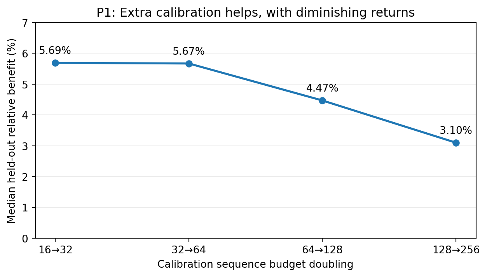
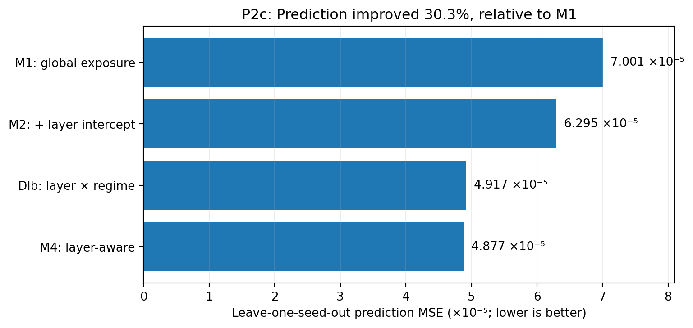
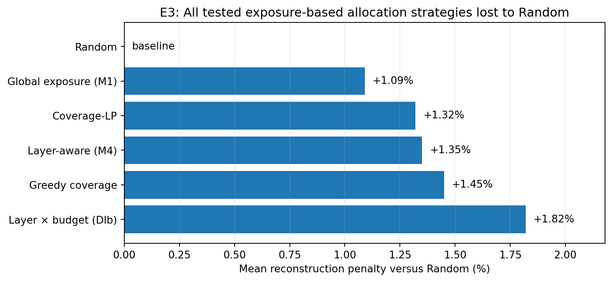
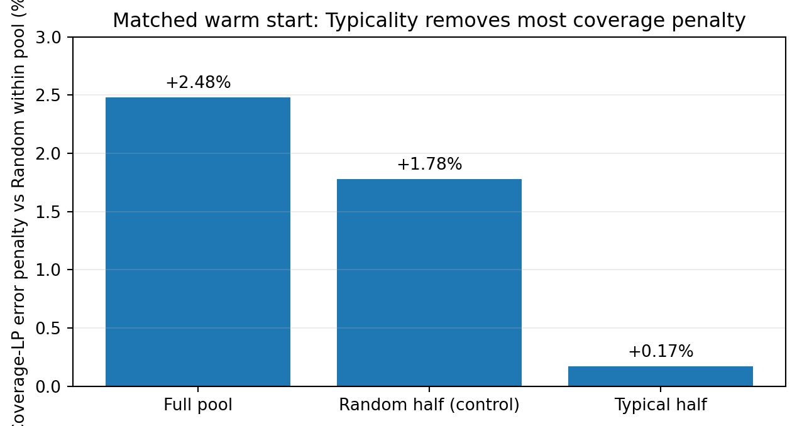
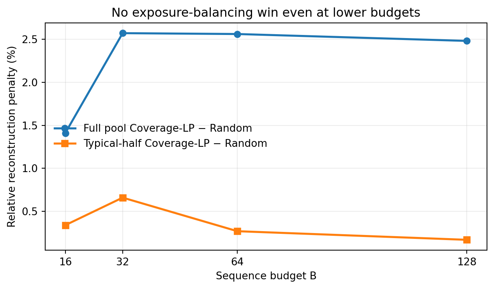
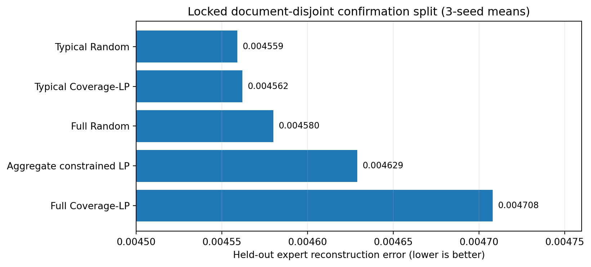
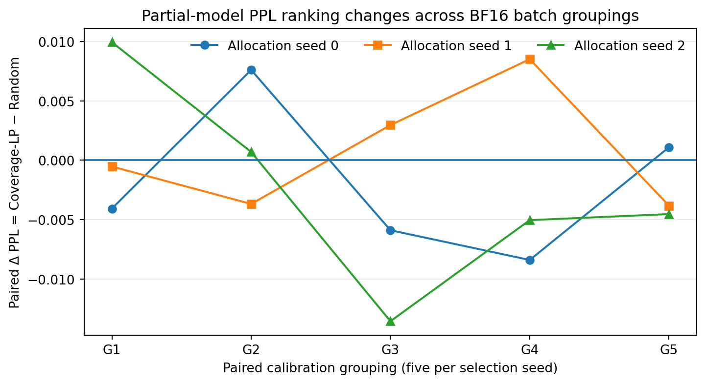
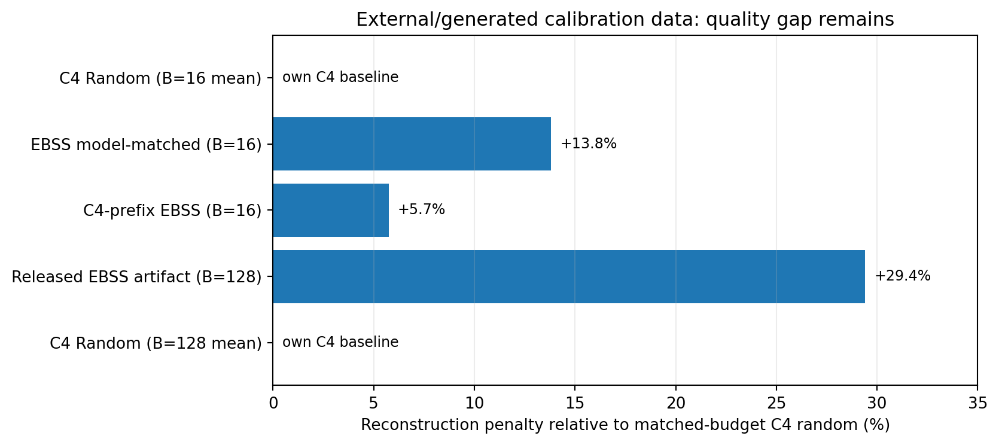
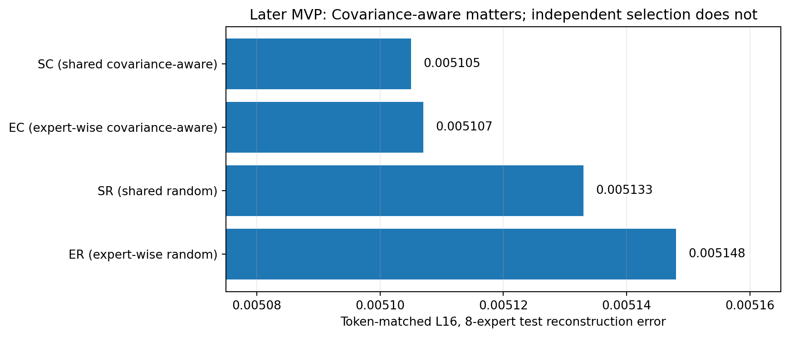

# From Calibration Sufficiency to Representativeness and Numerical Robustness

### CS498 research progress, from the original proposal to the latest expert-wise calibration MVP

**Project:** *Calibration-Sufficiency-Aware Budget Allocation for MoE Post-Training Quantization*  
**Model:** Qwen1.5-MoE-A2.7B  
**Purpose:** A readable research history, evidence map, and discussion guide for a meeting with the professor.  
**Prepared:** November 2026

> **One-sentence takeaway:** Better prediction of *which expert might benefit from more calibration* did **not** translate into better selection of *whole calibration sequences*. The strongest reproducible result is a negative one: count-driven allocation can improve exposure balance while selecting worse calibration evidence. Local reconstruction is robust in these tests; small model-level PPL rankings are not.

**Reading guide.** Sections 1–3 provide the quick overview and definitions. Sections 4–12 reconstruct the hypothesis–experiment–revision history. Section 13 separates findings from open claims. Section 14 contains likely professor questions and short answers. A numbered [source map](#15-source-map-and-reproducibility) points back to the original reports and code.

---

## 1. Meeting-ready executive summary

The original proposal hypothesized that **dynamic calibration state**—for example, Hessian drift, activation uncertainty, and router uncertainty—could identify MoE experts that need more calibration data than routed-token count alone suggests. We would use those expert scores to choose **B whole sequences**, without changing GPTQ.

The project developed through several distinct tests:

1. **Stabilize GPTQ first.** Default damping (`percdamp=0.01`) behaved pathologically with small calibration sets: going from 16 to 32 sequences made about **90% of experts worse**. A tuning-only sweep supported freezing `percdamp=1.0`.
2. **Validate the remaining-benefit label.** Under the stabilized solver, doubling calibration sequences consistently reduced held-out expert reconstruction error. The median improvement decreased from **5.69%** (16→32) to **3.10%** (128→256).
3. **Test the original dynamic-state hypothesis.** Drift, Hessian relative standard error, margin, and entropy showed some pooled associations, but **no reliable incremental predictive benefit** after stronger exposure baselines and held-out seed/layer validation.
4. **Discover layer/regime structure.** A layer-aware exposure predictor (M4) lowered leave-one-seed-out benefit-prediction MSE by **30.3%** versus global flexible exposure (M1). A simpler layer×budget model (Dlb) nearly matched it, so we can claim **layer/regime dependence**, not an independently identified continuous count curve.
5. **Run actual allocation.** At **B=128**, all five tested routing-driven/adaptive strategies lost to Random in expert reconstruction. Prediction gains did **not** become sequence-selection gains.
6. **Investigate why.** Adaptive selection barely changed typical expert-token counts (~**5%**) but favored **routing-atypical sequences**. With the warm start controlled, restricting candidates to the typical half reduced Coverage-LP reconstruction error by **2.47%** relative to full-pool Coverage-LP; it still did **not beat Typical Random**.
7. **Challenge explanations.** Low-budget sweeps, explicit representativeness constraints, and a locked confirmation split all reinforced the negative count-allocation result. Better aggregate routing balance by itself was not enough.
8. **Test model-level consequences.** An initial partial-model PPL comparison appeared to favor Random, but subsequent paired calibration-batching experiments reversed the rankings. **Expert reconstruction penalties remained stable; small PPL differences were dominated by numerical execution sensitivity.**
9. **Test other calibration signals and sources.** An older diagonal activation-aware swap pilot was inconclusive; EBSS-related calibration sets balanced routing in some settings but did not surpass natural C4 calibration under our pipeline. The latest **L16/8-expert covariance MVP** found a small benefit from shared covariance-aware selection (**+0.55%** vs shared random, token-matched), but **no extra gain from expert-wise independent selection** (**−0.04%** vs shared covariance-aware). This MVP has **not** established a 240-expert or PPL gain.

**Suggested 45-second verbal summary**

> We started with the idea that an expert's Hessian or routing state might tell us when it needs more calibration data. After stabilizing GPTQ, those dynamic signals did not generalize beyond strong exposure baselines. We did find robust layer- and budget-dependent patterns, improving benefit-prediction MSE by 30%, but the real whole-sequence allocation experiment was negative: every count-driven method lost to Random. The follow-up experiments suggest that those methods buy slightly better expert-token balance by selecting less representative sequences. Typicality constraints mitigate that failure without beating Random. Finally, we learned not to equate local reconstruction with model-level performance: the reconstruction gap is reproducible, but small PPL differences change with calibration batching. Our latest covariance pilot is promising locally, but remains exploratory.

---

## 2. Original proposal: question, algorithm, and promised evaluation

### Initial hypothesis — H0

> **If an expert's current calibration statistics reveal its remaining need more accurately than routed-token count, using that information in a fixed-budget sequence allocator should improve GPTQ quantization quality.**

The proposal described a **profiler → estimator → controller → unchanged GPTQ** pipeline:

**Original constraints:** select a subset of **B complete sequences** from a larger candidate pool; preserve the model's **natural routing**; do **not** change the quantization solver. Compare Random, coverage-aware, and sufficiency-aware selection; record both quality and systems overhead.

**Why the idea was plausible:** two experts with similar routed-token counts can have different activation distributions and Hessian convergence. Counting tokens may therefore miss which experts would improve most from additional evidence.

**What remained unproved in the proposal:** (a) whether a dynamic statistic predicts *actual future GPTQ benefit*, (b) whether the expert-level score remains useful when only full sequences can be chosen, and (c) whether improved expert reconstruction reaches model-level PPL.

### Research-plan evolution at a glance

| Stage | Hypothesis / research question | Main test | Outcome | Next revision |
|---|---|---|---|---|
| Proposal | Dynamic state predicts remaining calibration need beyond count | Drift pilot; proposed estimator | **Tentative only** | Stabilize and validate |
| P0 | Low-data GPTQ results are trustworthy | Damping sweep and nested sets | **Original setting failed** | Freeze stronger damping |
| P1 | Future benefit is a stable continuous target | Paired `m → 2m` characterization | **Supported** | Build predictors |
| P2/P2b | Drift/relSE/router state add robust predictive information | Strong baseline, held-out seed/layer tests | **Not supported robustly** | Focus on layer/regime effects |
| P2c | Exposure value differs by layer and calibration regime | M1/M2/Dlb/M4 prediction | **Supported for prediction** | Test actual selection |
| E3 | Better expert prediction improves fixed-B whole-sequence allocation | Joint LP vs Random/Coverage | **Rejected at B=128** | Diagnose selected data |
| Typicality | Coverage loses because it selects routing-atypical sequences | Typical-half + random-half controls | **Strong mitigation; not a winning allocator** | Test representativeness constraints |
| Constrained E3 | Routing representativeness repairs exposure allocation | Per-sequence and aggregate constraints | **Mitigation only** | Stop count-driven allocator tuning |
| Model-level | Local reconstruction ranks PPL outcomes reliably | Partial/full-depth PPL + grouping repeats | **Not reliable for small effects** | Explain numerical sensitivity |
| Activation/covariance | Activation-aware selection improves actual calibration | Single swaps; later 2×2 MVP | **Mixed / limited** | Validate shared covariance on all 240 experts before claims |

---

## 3. Experimental setup and what the metrics mean

### Common experimental setting

| Item | Main E1/E3 setting |
|---|---|
| Model | Qwen1.5-MoE-A2.7B |
| Routing | 60 routed experts per layer, **top-4** per token |
| Candidate source | **2,000** C4 sequences, **512 tokens** each |
| Layers studied primarily | **1, 8, 16, 23** → **240 routed experts** |
| Quantization | GPTQ, **4-bit**, group size **128**, act-order, `percdamp=1.0` |
| Controls | BF16 original weights; same solver and held-out evaluation universe |
| Seeds | Usually **3 allocation/characterization seeds** (0/1/2) |
| Main E3 budget | **B = 128 whole sequences** |
| Calibration | **Non-sequential:** each layer's Hessian uses original BF16 inputs |
| Excluded from quantization | Routers, shared experts, attention, norm, embeddings and other BF16 modules; partial setting quantizes only four layers' routed experts |

**Important scope qualifier:** 4-bit GPTQ here is not end-to-end packed INT4 deployment. PPL studies generally install dequantized GPTQ weights as BF16 (**fake quantization**) and run a full sequential forward. A separate full-depth pilot quantizes routed experts in all 24 layers, but leaves non-expert modules BF16.

### What is the local reconstruction metric?

For expert `e`, held-out sequence `s`, and projections `p ∈ {gate, up, down}`, the implementation measures:

\[
e_{e,s}(m)=
\frac{\sum_p\|X_{s,p}(W_p-\widehat W^{(m)}_p)^\top\|_F^2}
{\sum_p\|X_{s,p}W_p^\top\|_F^2}.
\]

Then average **per-sequence** relative errors over the common held-out evaluation sequences to obtain `E_e(m)`. It is a **normalized squared projection-output error**, not weight MSE, task accuracy, or PPL. The gate/up and down projection inputs come from the original BF16 model's natural routing. Actual `Profiler` storage caps each (sequence, expert, projection) at up to 128 held-out routed tokens.

The **remaining calibration benefit** label is:

\[
\Delta_e(m)=\frac{E_e(m)-E_e(2m)}{E_e(m)}.
\]

A positive `Δ_e` means that **re-quantizing from the original FP weights with twice as many nested calibration sequences** reduced held-out reconstruction error. Each starting set has three disjoint extension replicates in E1. The t-test is a **secondary** diagnostic on paired held-out sequences, not the definition of sufficiency.

**Why this target?** It directly matches the kind of output distortion GPTQ tries to minimize; normalization makes different experts more comparable; and **remaining improvement** is more actionable for allocation than current error alone. **Limitation:** a proportional reduction is not a model-loss-weighted absolute gain. Thus it does not guarantee that the final model's PPL will improve.

---

## 4. P0 → P1: stabilize quantization, then validate the target

### H1: Increasing calibration data should improve GPTQ, not make it worse

**Problem found.** With original damping `percdamp=0.01`, **16→32 sequences worsened reconstruction for roughly 90% of experts**. The low-data GPTQ/RTN comparison was also unfavorable. Checks of the Hessian accumulator, nested calibration sets and label construction did not support a simple implementation bug; the behavior was consistent with under-regularization/overfitting at small budgets.

**Intervention.** Sweep damping on tuning data **before** later prediction/allocation comparisons. Freeze **`percdamp=1.0`** for 4-bit GPTQ, group128, act-order. At 1.0, the tuning average was about **0.00487**; nearly tied with 1.5, while the original 0.01 had about **0.00775** in the damping diagnostic. The stabilized solver restored monotone improvement in the tested doubling transitions.

**P1 result:** under the frozen quantizer, the median held-out relative benefit of adding an equally sized disjoint extension was:

| Calibration size change | Median relative improvement | Mean relative improvement |
|---|---:|---:|
| 16 → 32 | **+5.69%** | +5.86% |
| 32 → 64 | **+5.67%** | +5.69% |
| 64 → 128 | **+4.47%** | +4.46% |
| 128 → 256 | **+3.10%** | +3.10% |

*Figure 1. These are relative reductions in held-out expert reconstruction error, **not** reductions in PPL. The decline in benefit motivates a remaining-need estimator.*

**Hypothesis update:** a continuous `m → 2m` benefit target is meaningful **under a stable GPTQ configuration**. But merely passing a significance test does not distinguish experts' remaining benefit: the *size* and regime dependence matter.

---

## 5. P2/P2b → P2c: the original predictive hypothesis fails, a simpler one survives

### H2: Dynamic calibration-state signals predict benefit beyond token exposure

Candidate signals included **normalized Hessian drift**, **relative Hessian standard error (relSE)**, **router top-k margin**, and **router entropy**. Early correlations looked promising against a linear count baseline. The stronger test used a **flexible exposure baseline** (log count, powers through cubic, budget terms and count×budget interactions), with held-out characterization seeds and layers.

Key results:

- Budget-interacted **relSE:** +**9.2%** pooled leave-one-seed-out MSE improvement, but **−6.1%** on one seed and **−17.4%** on one held-out layer.
- Budget-interacted **drift:** +**8.6%** pooled, but **−5.4%** on one seed and **−19.1%** on a held-out layer.
- Router **margin/entropy** were largely persistent **expert descriptors**, not dynamic within-expert calibration-state signals.
- Once layer-specific exposure was modeled, drift and relSE did **not** provide reliable incremental gains.

**Decision:** **P2 CASE B / P2b UNSTABLE**. This rejects the **robust incremental-predictive-value** claim, not the possibility that individual statistics carry some descriptive correlation.

### Revised H3: The marginal value of exposure is layer- and regime-dependent

The revised prediction models focused on **routed-token count, layer, and starting sequence budget**, without the rejected dynamic signals:

| Model | Core information | LOSO MSE ↓ | Gain vs M1 |
|---|---|---:|---:|
| M1 | Global flexible exposure | **7.001 × 10⁻⁵** | — |
| M2 | M1 + layer intercept | 6.295 × 10⁻⁵ | +10.1% |
| Dlb | Layer × budget means | 4.917 × 10⁻⁵ | **+29.8%** |
| M4 | Layer-aware count/regime interactions | **4.877 × 10⁻⁵** | **+30.3%** |

*Figure 2. A major gain in **prediction MSE**, not in GPTQ reconstruction quality. Dlb nearly matching M4 weakens the claim of an identifiable continuous layer-specific count curve.*

Additional checks:

- M4 improved over layer intercepts in every held-out seed and in expert-grouped validation.
- **Layer priorities change with regime:** at a starting budget of 16, L1 had the largest predicted proportional benefit (~0.074); at 128, L8 was higher (~0.035) and L1 lower (~0.029).
- **Within a fixed layer, predicted utility and inverse-count coverage ranked experts identically** under the tested monotone utility condition (100% rank agreement). M4's gain was primarily in **cross-layer** priorities/magnitudes.

**Important limitation:** routed count and number of sequences rise together. Layer-by-budget means almost matching M4 means we can defend **layer/regime heterogeneity**, but not a uniquely isolated continuous token-response law.

**Hypothesis update:** H3 is **supported for offline prediction**. Whether that is useful for feasible selection is a *separate* test.

---

## 6. Exp4 and E3: from expert prediction to actual whole-sequence allocation

### First warning: source diversity can matter even at matched routed-token count

The source-diversity characterization compared calibration samples with similar numbers of routed tokens but different numbers of distinct source sequences:

| Starting regime | Natural sources | Spread sources | Change in expert reconstruction error |
|---|---:|---:|---:|
| `m=32`, ~1,092 routed tokens/expert | 32 | 244 | **−3.04%** |
| `m=128`, ~4,369 routed tokens/expert | 128 | 255 | **−1.22%** |

Concentrating similar token counts into fewer sources **worsened** reconstruction. Greater source diversity was associated with larger Hessian effective rank, but causality was not uniquely established.

**Crucial caveat:** the spread conditions use **more than B source sequences**, so they are **not valid fixed-B whole-sequence allocators**. This finding says *quality of evidence matters beyond count*; it does not provide a feasible sequence-selection improvement.

### E3's actual decision problem: one sequence affects many experts

For each candidate sequence `s` and expert `e` (including its layer), profiling gives a routed-token count `C[s,e]`. With current count `n_e`, the learned allocator uses an approximate per-token value:

\[
u_e=\frac{\max(\widehat\Delta_e,0)}{n_e}.
\]

It solves a relaxed joint LP each round:

\[
\max_{z,y}\sum_e u_e y_e,
\quad
0\le y_e\le n_e,
\quad
y_e\le\sum_s C_{s,e}z_s,
\quad
\sum_s z_s=b,
\quad
0\le z_s\le 1.
\]

**Interpretation:** `z_s` is a **shared sequence-selection variable**; choosing one sequence credits **all** naturally routed experts. The `y_e ≤ n_e` cap reflects the characterized **doubling** regime, so benefit beyond one extra `n_e` is not rewarded by the same label. `z_s` is fractional in the LP and must be rounded to actual discrete sequence IDs. The objective is **count-based**, not an estimate of actual activation-quality gains or PPL.

**B=128 execution:** 32 common random warm-start sequences, then two **48-sequence** adaptive rounds; each round refreshes the routed counts and M1/Dlb/M4 utilities. The quantizer remains fixed.

### Why was B=128 chosen? Random still had measurable headroom

Before comparing allocation policies, a Random-only headroom curve on the common held-out evaluation setup gave:

| Random calibration budget B | Mean expert reconstruction error ↓ |
|---|---:|
| 32 | 0.00511 |
| 64 | 0.00483 |
| **128** | **0.00462** |
| 256 | 0.00448 |
| 512 | 0.00439 |

Thus **B=128** was a tractable regime where more calibration data still improved reconstruction: Random's error fell by about **2.89%** going from 128 to 256 sequences. This is *headroom from doubling the overall budget*, not a guaranteed improvement available from clever selection at the same B.

### H4: Better expert predictions improve whole-sequence calibration

**This hypothesis failed in the first actual allocation test.** All 18 strategy×seed runs completed (three seeds; 240 expert evaluation universe). All adaptive strategies were worse than Random on all three seeds.

| Strategy | Mean held-out reconstruction error ↓ | Penalty vs Random |
|---|---:|---:|
| **Random** | **0.004616** | — |
| Global exposure (M1) | 0.004666 | +1.09% |
| Coverage-LP | 0.004677 | +1.32% |
| Layer-aware (M4) | 0.004678 | +1.35% |
| Greedy coverage | 0.004683 | +1.45% |
| Layer × budget (Dlb) | 0.004700 | +1.82% |

*Figure 3. All performance differences are **penalties** in expert reconstruction, not PPL. This was the decisive pivot from “improve expert utility prediction” to “explain why selected sequences are worse.”*

**Why the result surprised us:** learned utilities **did** change selected sequence IDs and cross-layer weighting, but an expert's routed-token count typically moved by only about **5%** relative to Random. Such a small count shift was unlikely to explain **~1–2%** reconstruction loss. The selected sequences had larger **per-sequence routing L1 distance** (~0.40–0.42 vs ~0.33 for Random), lower routing entropy, and much larger set-level JS divergence.

**Revised hypothesis H5:** coverage/exposure objectives over-select atypical routing examples; the data's representativeness and source diversity may outweigh small exposure-balance gains.

**Not tested:** the midterm's absolute-benefit utility `u_abs = max(Δ̂_e × Ê_e,0)/n_e`. The repo explicitly says it was **not implemented**: there was no validated base-error estimator in the prediction table. Do **not** claim an experimental result for this ablation.

---

## 7. Typicality filtering: a controlled intervention on candidate eligibility

### What “routing-typical” means

For sequence `s`, layer `L`, and expert `e`, define:

\[
p_s(L,e)=\frac{c_{s,L,e}}{\sum_j c_{s,L,j}},\qquad
p_{pool}(L,e)=\frac{\sum_{s\in pool}c_{s,L,e}}{\sum_{s\in pool}\sum_jc_{s,L,j}}.
\]

Then calculate a per-sequence routing typicality distance:

\[
d(s)=\frac{1}{4}\sum_{L\in\{1,8,16,23\}}\left\|p_s(L,\cdot)-p_{pool}(L,\cdot)\right\|_1.
\]

Every 512-token sequence contributes **512 × top-4 = 2,048** expert assignments **per layer**. The **typical half** consists of the **1,000 lowest-distance** sequences from the original 2,000-sequence C4 pool (median cutoff about `d ≤ 0.321`). This is based **only on routing**, not on test reconstruction labels.

### H5 test: does typical-pool eligibility remove the coverage penalty?

The controlled comparison uses the **same ordered 32-sequence warm start** for each seed across pools/strategies. A **random half** of 1,000 candidates is a pool-size control.

| Candidate pool | Random error ↓ | Coverage-LP error ↓ | Coverage penalty |
|---|---:|---:|---:|
| Full 2,000 | 0.004615 | 0.004730 | **+2.48%** |
| Random half 1,000 | 0.004615 | 0.004697 | **+1.78%** |
| **Typical half 1,000** | **0.004606** | **0.004613** | **+0.17%** |

*Figure 4. Filtering to routing-typical candidates removes most of Full Coverage-LP's penalty but **does not make Coverage-LP better than Typical Random**.*

**Most informative contrasts:**

- Typical Coverage-LP vs **Full Coverage-LP:** **−2.47%** reconstruction error (all 3 seeds; all 4 layers).
- Typical Coverage-LP vs **Typical Random:** **+0.17%** worse (0/3 seeds better).
- Full-pool Coverage-LP post-warm routing distance: **0.449**; after typical filtering: **0.297**.
- Exposure Gini barely changed (**0.043 → 0.046**), while median effective source diversity improved by about **8 sources**.

**Interpretation:** restricting eligibility to typical examples can mitigate the loss caused by coverage-driven selection. This is stronger than a simple correlation, because the eligibility set is deliberately changed and the random-half control addresses pool size. But **routing typicality, source diversity, and activation quality may still be confounded**—this is not proof of a single causal mechanism.

---

## 8. Tests designed to falsify simpler explanations

### H6: Maybe coverage helps only when calibration budget is very small

A controlled sweep reduced the budget but kept GPTQ, allocation rule, evaluation, and matched warm-start policy fixed:

| B (whole sequences) | Full-pool Coverage-LP penalty | Typical-pool Coverage-LP penalty |
|---|---:|---:|
| **16** | +1.41% | +0.34% |
| **32** | +2.57% | +0.66% |
| **64** | +2.56% | +0.27% |
| **128** | +2.48% | +0.17% |

*Figure 5. All values are relative reconstruction penalties against the matched Random condition in that same pool and budget.*

At **B=16**, the full-pool Random exposure distribution had **no experts with zero tokens or fewer than 128 routed tokens**, across the 240 experts; the minimum averaged about **361**. The problem was not literal expert starvation. An exploratory **CPU-only** B=4/8 study found B=4 genuinely count-scarce, but Coverage-LP **worsened** the lower exposure tail. **No GPTQ result was run at B=4/8**; do not interpret that study as a reconstruction comparison.

**Decision:** reducing B did not uncover a count-allocation win.

### H7: Can a soft representativeness constraint rescue full-pool Coverage-LP?

Two approaches were tested:

**Per-sequence constraint.** Keep the entire pool, but limit the mean selected sequence typicality distance. It improved relative to Full Coverage-LP (**−1.62%**), yet was **+1.03% worse than Typical Random** on the older test split.

**Aggregate-routing constraint.** Restrict each layer's **final set-level routing distribution** to be close to the full-pool distribution; use horizon-aware LP with exact integer-feasibility checks. On a separately constructed, document-disjoint confirmation split, it improved on Full Coverage-LP (**−1.67%**) but was **+1.53% worse than Typical Random**, in all three seeds and every layer.

| Strategy | Locked confirmation error ↓ | Difference vs Typical Random |
|---|---:|---:|
| **Typical Random** | **0.004559** | — |
| Typical Coverage-LP | 0.004562 | +0.07% |
| Full Random | 0.004580 | +0.45% |
| Aggregate-constrained Coverage-LP | 0.004629 | **+1.53%** |
| Full Coverage-LP | 0.004708 | +3.27% |

*Figure 6. This is the separately held-out **confirmation** split, not the old exploratory test split. These means cannot be directly compared with the original E3 numbers from another split.*

**Key counterexample:** Aggregate-constrained Coverage-LP had the **smallest mean aggregate routing L1 shift** (`0.0302`), but worse reconstruction than Full Random; its selected **individual** sequences were much more atypical (`d ≈ 0.392`) than Typical Random (`d ≈ 0.289`). Individually skewed sequences can **cancel** in an aggregate routing histogram while still providing poor calibration evidence. Its expert-token Gini was **0.033**, better balanced than Typical Random's **0.065**, yet its reconstruction was worse.

**Conclusion:** balancing expert counts or a single aggregate routing statistic is **not sufficient** to produce good calibration sequences. A representativeness constraint can mitigate a bad objective without making that objective useful.

### Activation mismatch: a closer explanation, still not a proof

A **post-hoc**, read-only covariance diagnostic computed expert gate/up second-moment mismatch against an independent *source* of tuning activations:

| Strategy | Relative covariance Frobenius mismatch | Expert reconstruction |
|---|---:|---:|
| Full Random | 0.273 | 0.004615 |
| Typical Random | 0.289 | **0.004606** |
| Full Coverage-LP | **0.372** | **0.004730** |
| Per-sequence constrained LP | 0.293 | 0.004653 |

Across **21 correlated runs**, Spearman(`covariance mismatch`, `reconstruction`) ≈ **+0.74**. This is **descriptive**, not causal or a clean out-of-sample predictive validation (the tuning source had been used for earlier decisions). In particular, the numerically smallest mismatch is **not** automatically the best reconstruction.

An additional **single-sequence swap** pilot (L16, 8 experts, one seed) tested whether **diagonal** activation second-moment mismatch predicts whether a proposed swap actually helps GPTQ. Across **9 evaluated swaps**, predicted versus actual gain had Spearman **+0.12**; “predicted beneficial” swaps were not better than random swaps. **Decision: inconclusive**, and no validated activation-aware swap allocator resulted.

---

## 9. From local reconstruction to model-level PPL: a second, important gap

### First full-forward check: partial-model GPTQ

With routed experts quantized only in **L1/8/16/23**, while the rest stayed BF16, the team evaluated **128 WikiText-2 windows × 512 tokens**, i.e. **65,408 next-token targets**. The same frozen windows and loss calculation were used for all strategies.

| Method | Mean partial-model PPL ↓ | Delta vs BF16 | Reconstruction mean (older matched runs) |
|---|---:|---:|---:|
| **BF16** | **9.2371** | — | — |
| Typical Random | 9.2683 | +0.0312 | **0.004606** |
| Full Random | 9.2694 | +0.0323 | 0.004615 |
| Typical Coverage-LP | 9.2725 | +0.0354 | 0.004613 |
| Full Coverage-LP | 9.2780 | +0.0409 | 0.004730 |

**Initial descriptive association:** across 12 configurations, reconstruction/PPL Spearman was **+0.52**, but after dropping the clearly worse Full Coverage-LP group, it was **0.00** over the remaining 9. The differences among FR/TR/TC were too small to rank reliably using the local metric.

### Critical falsification: PPL ranking changes with calibration batch grouping

The same **selected sequence IDs**, GPTQ settings and evaluation windows were kept fixed. Only the **BF16 batch composition during calibration-input extraction** changed. Over **3 selection seeds × 5 paired grouping choices**, the paired `FC − FR` PPL difference changed sign repeatedly:

*Figure 7. Positive values favor Full Random; negative values favor Full Coverage-LP. Groupings within an allocation seed are repeated executions of the **same selected IDs**, not independent selection seeds.*

| Quantity | Result |
|---|---:|
| Original-extraction mean `FC − FR` PPL | **+0.0086** (apparently FC worse) |
| Paired grouping-averaged mean | **−0.00125** |
| Pooled within-seed grouping SD | **0.00687** |
| Hierarchical bootstrap 95% interval | **[−0.00478, +0.00216]** |
| Pairings where FC is worse | **6/15** |
| FC expert reconstruction penalty under these groupings | **+2.2–2.7%**, **15/15** |

**Revised interpretation:** the **local reconstruction difference is stable**, but the **small PPL sign and ranking are not resolved above calibration-execution numerical variation**. It would be wrong to use the original-extraction PPL ranking alone as proof of model-level superiority.

**Why this can happen:** in BF16, small activation changes can flip near-tied MoE top-4 assignments. At deeper layers, a few percent of token–expert memberships can change, shifting expert Hessians, act-order permutations, quantization groups and rounding decisions. Fixed groupings reproduce weights/PPL bitwise, so this is **sensitivity to numerically equivalent execution paths**, not simply non-deterministic evaluation.

### Further numerical controls (supporting, not a single proved causal chain)

| Control | Intervention | Finding |
|---|---|---|
| Full-depth pilot | Quantize routed experts in **all 24 layers**, seed 0 | FR **9.3647** PPL; FC **9.3707**; FC−FR **+0.00594**, 95% NLL CI includes zero. Reconstruction FC penalty ~**2.61%** across 24 layers. |
| Frozen-routing factorial | Freeze reference routing assignments during Hessian construction while varying activation source | Routing membership changes account for much of the Hessian difference; effects on weights and PPL interact with changed activation values. |
| Frozen-routing robustness | Repeat across five groupings | Hessian differences shrink, but not all strategy-specific or paired PPL variation disappears; one installation check was flagged and audited. |
| Fixed act-order | Hold act-order and 128-column group membership fixed | Effective-weight difference reduced by about **41%** under a frozen-routing comparison; PPL spread falls for some contrasts but not uniformly. |
| **Hessian accumulation-order null** | Same sequences, same activations, routing and fixed act-order; change only FP32 addition order | Hessian relative Frobenius shift about **9×10⁻⁸**; about **0.007%** effective-weight elements change; PPL varies by **up to 0.00359** vs original, with almost unchanged reconstruction. FP64 accumulation removes this order-dependence in the tested Hessians. |

**What these tests establish:** large model-level conclusions cannot rest on a single low-bit calibration extraction. **What they do not establish:** a universal, fully quantified causal decomposition of PPL variance into routing, permutation, and FP32-summation contributions. These are interventions in a specific model/hardware/kernel stack.

### Computation: why not optimize PPL directly?

| Measured item | Approximate wall time in the four-layer pipeline |
|---|---:|
| Hessian replay, 128 sequences × 4 layers | **~32 s** |
| GPTQ solving, 240 experts | **~205 s** |
| Quantize/install/reconstruction checks combined | **~266 s** |
| **One full 24-layer PPL evaluation**, 128 WikiText windows | **22–44 s** |
| Full-pool routing profiling for some adaptive allocators | **~357 s** full-forward equivalent |

The expensive part of **searching** with PPL is repeatedly **recomputing Hessians and re-quantizing experts for each proposed calibration set**, not simply one final PPL forward. Neither equal sequence budget nor lower local reconstruction implies equal-compute or better model-level PPL.

---

## 10. External-method and generated-data checks: is exposure balance enough?

The project also investigated the **Expert-Balanced Self-Sampling (EBSS)** idea from MoEQuant. These are separate calibration-data experiments, **not reproductions of MoEQuant's complete quantization method** (which also includes other mechanisms such as affinity guidance).

### Released EBSS artifact as calibration data (B=128)

A public 600-record EBSS text artifact contained substantial repetition and duplication. Its **generating checkpoint and precise settings could not be verified**. Under our unchanged GPTQ/evaluation pipeline, a frozen extraction of 128 eligible windows gave:

- **EBSS artifact:** reconstruction **0.005971**.
- Matched C4 Full Random: about **0.00461**; released-artifact penalty **+29.4%**.
- **0/240 experts** improved relative to the matched C4 baselines.
- The released set had much higher routing-load CV and much lower text diversity.

**Interpretation:** this is a **limited artifact-transfer comparison**. It does **not** refute the published MoEQuant method or establish that faithful EBSS generation would always fail.

### Model-matched generated EBSS sets (B=16)

A separate pilot used the actual base model and controlled beam generation. Its original score normalization **mildly improved** routing balance relative to probability-only generation, but produced highly repetitive text and worse GPTQ calibration than natural C4:

- A model-matched EBSS variant was about **+13.8% worse** in reconstruction than C4 Random at B=16.
- Stronger Algorithm-1-style balance normalization could match the approximate load balance of C4, **yet still remained +12.9–13.4% worse** in reconstruction than C4.
- Replacing 64 of each 512 generated tokens with natural C4 prefixes recovered **~54–57%** of the reconstruction gap, but **prefix EBSS still remained +5.74% worse** than the B=16 C4 mean and cost **~1,119 seconds** of generation.
- PPL rankings across these generated sets were not reliably resolvable at the observed numerical scale.

*Figure 8. Penalties are compared **within the same calibration budget** (B=16 or B=128); never compare raw errors across those budgets. Each B=16 generated condition used only one generation draw.*

**Research implication:** balanced expert exposure can be constructed while the calibration text remains too repetitive or distributionally mismatched to be useful. Generation quality, source diversity and acquisition cost matter. The external-method claims must remain limited to the configurations tested.

---

## 11. Latest local extension: expert-wise vs shared covariance-aware calibration

**Source status:** This section uses the **user-supplied** `update_expertwise_calibration_mvp.md`. Its code/results were **not verified on the repository's default branch** during preparation. It is a later local MVP and **not** a completed 240-expert E3 comparison.

### H8: Is shared whole-sequence selection itself the bottleneck?

A follow-up tested **L16, 8 experts chosen across routing-frequency ranks, B=128, three seeds**. Four conditions separate two factors:

| | Random | Covariance-aware selection |
|---|---|---|
| **One shared sequence set** | **SR** | **SC** |
| **Independent sequence set per expert** | **ER** | **EC** |

The covariance objective uses deterministic **64-dimensional projected gate/up and down second moments**, matched to the **2,000-sequence candidate-pool covariance**. GPTQ and test activations are unchanged. Crucially, the final routed-token counts are **matched per expert across conditions**.

| Condition | Test reconstruction error ↓ | Confirmation error ↓ |
|---|---:|---:|
| SR — Shared Random | 0.005133 | 0.005091 |
| **SC — Shared Covariance-aware** | **0.005105** | **0.005060** |
| EC — Expert-wise Covariance-aware | 0.005107 | 0.005061 |
| ER — Expert-wise Random | 0.005148 | 0.005107 |

*Figure 9. **Different evaluation universe and token matching from E3.** Raw error numbers must not be placed into the 240-expert E3 ranking.*

**Controlled comparisons:**

- **SC vs SR:** **+0.55%** relative reconstruction improvement on test and **+0.62%** on confirmation; **8/8 experts** improve on seed averages.
- **EC vs ER:** **+0.81%** on test; **8/8 experts** improve.
- **EC vs SC:** **−0.04%** on test and **−0.03%** on confirmation; **no reliable benefit** from removing shared selection after matching tokens.
- Without token matching, EC appears **+0.23%** better than SC, but it also supplies **4–14% more tokens** to the experts. That apparent advantage vanishes with matching.
- EC reduces covariance mismatch beyond SC, but the additional reduction **does not predict** better GPTQ reconstruction. EC also reads a union of **771–787** sequences across eight experts versus **128** for SC.

**Updated interpretation:** the shared-sequence constraint does **not** explain away the earlier negative count-allocation results in this limited test. Covariance-aware selection is a **promising small local signal**, but **further surrogate improvement does not necessarily give further reconstruction improvement**, and the extra profiling/selection expense remains substantial.

**What has not been done:** Shared Covariance-aware **has not yet been validated under the original E3 protocol across 240 experts and four layers** against FR/TR/TC. No reliable PPL gain follows from this MVP.

---

## 12. Cumulative hypothesis verdicts and what we should claim

### Claims supported by the recorded experiments

1. **Default low-data GPTQ damping can confound calibration-quality studies.** The 0.01 configuration showed pathological worsening; the stabilized solver produced reliable positive E1 benefits over tested budgets.
2. **Marginal relative calibration benefit depends on layer and sequence-budget regime.** M4/Dlb predict better than global exposure on held-out characterization data, but this is **offline prediction**.
3. **The tested count-driven whole-sequence allocations do not beat Random** at the evaluated budgets/configuration; their selected calibration examples can be more routing-atypical.
4. **Typical-pool eligibility and constrained selection mitigate Coverage-LP losses, but do not recover a robust advantage over Random.** A separately held-out confirmation split supports the negative allocation conclusion.
5. **Local reconstruction and model-level PPL have different stability.** A persistent ~2–3% expert reconstruction gap does not establish a reproducible PPL ranking when calibration-batching variation is of similar magnitude to the PPL difference.
6. **The new, narrow L16 covariance MVP suggests a small advantage from shared covariance-aware selection**, not from independent expert-wise selection. It is not a full-E3 or PPL result.

### Claims **not** supported (do not accidentally state them in the meeting)

- “Hessian drift reliably measures calibration sufficiency beyond a strong count/layer baseline.” **No.**
- “30.3% lower predictor MSE means 30.3% lower GPTQ error.” **No.**
- “The LP solves calibration quality, not just routed-token count allocation.” **No.**
- “Source diversity alone was proved causal.” **No.** The spread experiment changed the source count and is not fixed-B feasible.
- “Typical Random is a robust model-level PPL winner.” **Not established.**
- “Full Coverage-LP always worsens PPL.” **Not under grouping robustness.**
- “Absolute-benefit `u_abs` was implemented.” **No; proposed only.**
- “EBSS as published was faithfully reproduced and disproved.” **No.**
- “Expert-wise covariance buffers improve E3.” **No in the token-matched eight-expert MVP; global budget differs.**
- “All 24 layers are fully INT4-quantized and inference is faster.” **No.**

### What makes this a coherent research project rather than a sequence of failed methods?

The experiments **changed the hypothesis in response to counter-evidence**:

**Dynamic state beyond exposure** → rejected under strong controls → **layer/regime exposure structure** → supported for prediction → **joint whole-sequence allocation** → failed → **routing typicality and activation evidence quality** → explanatory/mitigating results → **PPL validation** → numerical robustness becomes essential → **covariance-aware pilot** → a bounded local positive result with clear missing validations.

The most defensible contribution is **characterizing when predictive and allocation proxies fail, and why apparent model-level gains need stronger numerical controls**—with one narrow promising covariance follow-up rather than an unsupported claim of a new best allocator.

---

## 13. How to frame the discussion with the professor

**Recommended 5-minute route:**

1. **30 seconds — Original research question.** “We wanted to select B calibration sequences using expert sufficiency information rather than raw coverage.”
2. **50 seconds — Why we changed predictors.** Default damping was unstable; drift did not generalize; layer/regime dependency did (show Figure 2).
3. **60 seconds — The decisive E3 result.** Prediction gain did not transfer to selection (show Figure 3). Explain shared routing matrix and LP coupling.
4. **60 seconds — Mechanism.** Coverage picks atypical examples; typical filtering removes most of the penalty (show Figure 4); low-budget and aggregate constraints rule out simple alternatives.
5. **50 seconds — PPL caution.** A stable reconstruction penalty did not yield a robust model-level PPL ranking (show Figure 7).
6. **30 seconds — Recent exploratory extension and what guidance you want.** Shared covariance-aware shows a small local gain; ask whether to expand it or consolidate a strong negative-results final report.

**A good closing question to ask the professor:**

> Given that the count-based allocator consistently fails under fixed-B controls, and that local reconstruction does not reliably order small PPL differences, would you prioritize a careful negative-results paper/report explaining these mechanisms, or one tightly controlled full-E3 test of shared covariance-aware selection?

---

## 14. Predicted professor Q&A (with concise answers)

### Q1. “What is your main contribution if your original hypothesis failed?”

**A.** The project validated a reliable remaining-benefit target, found robust layer/regime exposure structure, and—most importantly—showed that improved expert-level prediction does not automatically improve feasible whole-sequence calibration. Controlled typicality, scarcity, confirmation, and numerical-robustness experiments explain the limits of count-based allocation without claiming a winning new method.

### Q2. “Why did Hessian drift look promising initially but fail later?”

**A.** Early comparisons used weaker exposure baselines and an unstable low-data damping setting. Once we froze GPTQ, compared against flexible count/layer models, and held out seeds and layers, the drift benefit was inconsistent; layer heterogeneity explained much of the association. We do not claim drift is useless, only that it is not a robust incremental predictor in this setup.

### Q3. “What exactly is `E_e(m)`? Is it PPL?”

**A.** No. It is the mean, over held-out sequences, of the relative **squared output distortion** of an expert's gate/up/down linear projections between BF16 weights and the GPTQ-quantized weights trained with `m` calibration sequences. We re-quantize from the original weights at `2m` and score on the **same** held-out activations.

### Q4. “Why use `(E(m) − E(2m)) / E(m)` rather than current error?”

**A.** Current error alone does not indicate **how much more data can help**. The relative future reduction measures *remaining return to calibration* and makes experts with different output scales more comparable. Its limitation is that it does not weight absolute baseline error or the effect on downstream model loss.

### Q5. “Why did a 30.3% prediction MSE improvement not produce better quantization?”

**A.** The MSE measures **offline prediction** of a hypothetical doubling benefit, not how accurately we can rank complete sequences. Within layers, monotone exposure utilities often rank experts exactly like inverse-count coverage; cross-layer weights differ, but whole sequences couple many experts and the utility ignores activation distributions and redundancy. The allocation experiment is the actual test, and it was negative.

### Q6. “How does the LP handle a sequence that routes to several experts?”

**A.** We profile a matrix `C[s,e]` of natural routed-token counts, then solve one joint LP in which each sequence has **one common decision variable** `z_s`. That variable contributes to every expert's capacity constraint `y_e ≤ Σ_s C[s,e] z_s`; experts cannot independently request different full sequences. The LP jointly handles **count coupling**, not **activation quality**.

### Q7. “Why not use a greedy selector?”

**A.** A greedy rule optimizes the immediate routed-count reward, whereas the LP optimizes a full **batch of sequences** with per-expert saturation caps. In our actual runs, the distinction did not change the scientific conclusion: greedy coverage and Coverage-LP both lost to Random. And the code's greedy coverage score is not exactly the same capped objective as the LP.

### Q8. “Why not multiply relative benefit by baseline reconstruction error, or directly predict absolute benefit?”

**A.** That was proposed as `u_abs`, but it was **never implemented**. It requires a reliable, training-only baseline-error estimator not present in the exported P2 table. After exposure-only allocation failed, we prioritized identifying selection bias rather than adding a new weighting that might chase the same atypical sequences. We cannot claim that absolute weighting would fail.

### Q9. “Does the source-diversity experiment violate the fixed B budget?”

**A.** Yes, deliberately. It is a **mechanism characterization** with routed-token count matched and more source sequences, not a valid B-sequence allocation policy. It motivates examining within-expert evidence quality; it does not demonstrate a feasible selection gain.

### Q10. “How did you define routing typicality? Did you use test labels?”

**A.** For each sequence, normalize its top-4 expert routing counts within each studied layer, compare that distribution to the original candidate-pool distribution using L1 distance, then average over four layers. The lowest-distance half becomes the typical candidate pool. It uses only candidate routing, **not test reconstruction labels**.

### Q11. “Why is the typicality result not simply a smaller candidate-pool artifact?”

**A.** We compared a 1,000-sequence **typical half** with a separate 1,000-sequence **random half**, while matching the initial 32 selected sequences. The random-half control did not remove the coverage penalty, but the typical half largely did. This supports an eligibility/representativeness explanation while leaving source diversity and activation distribution partly confounded.

### Q12. “Why doesn't matching the final set's aggregate routing distribution solve the problem?”

**A.** An LP can choose individually unusual sequences whose routing biases cancel in aggregate. The aggregate-constrained set had the closest overall routing histogram to the pool, yet remained worse than Random in held-out reconstruction. Aggregate balance does not guarantee that **each expert's calibration activations are representative**.

### Q13. “Maybe coverage matters only for rare or starved experts?”

**A.** Our B=16–128 GPU sweeps did not support that: Coverage-LP never reliably beat matched Random. At B=16 the studied experts were not literally zero-token or below 128 routed tokens. An additional CPU-only B=4 analysis found genuine scarcity but the existing coverage controller actually worsened the lower exposure tail; no B=4 GPTQ claim is made.

### Q14. “Is reconstruction a valid proxy for model-level PPL?”

**A.** It is well aligned with **local GPTQ projection distortion**, but it is not a guaranteed proxy for end-to-end loss. In the initial four-layer PPL experiment Spearman was ~0.52, mostly driven by the obviously worse Full Coverage-LP case; among FR/TR/TC it was ~0.00. With paired BF16 grouping changes, the ~2–3% local reconstruction penalty persisted but the PPL ranking often flipped. The correct claim is local quality, with separate model-level validation.

### Q15. “What causes the PPL instability: evaluation noise or calibration noise?”

**A.** The PPL evaluator is repeatable for a fixed quantized model. The sensitivity appears when **calibration activations** are regenerated under different BF16 batch compositions, which can change near-tied router assignments, Hessians, act-order and quantization rounding. Order-only FP32 Hessian accumulation also moves PPL by a few thousandths even with fixed routing/act-order. The individual mechanisms have been tested, but we do not have a universal additive variance decomposition.

### Q16. “Why not optimize PPL directly instead of reconstruction?”

**A.** One PPL forward was only **22–44 seconds** in our pipeline; the expensive part is *repeatedly generating a new quantized model* for candidate sets (~**205 seconds** GPTQ for 240 experts, plus Hessian replay/installation). PPL is also sensitive to numerical calibration execution at the scale of the differences we are trying to optimize. Local reconstruction is a cheaper, directly GPTQ-related diagnostic, but needs final PPL checks.

### Q17. “How is this different from MoEQuant or EAQuant?”

**A.** Our primary intervention is **which existing natural-text sequences to acquire under a fixed whole-sequence budget**, with GPTQ unchanged. MoEQuant and EAQuant combine sampling with other quantization-specific mechanisms. Our released EBSS-file result is only an artifact-transfer test, not a full reproduction or refutation of MoEQuant.

### Q18. “What is the most promising new method now?”

**A.** The narrow covariance MVP found **+0.55%** token-matched reconstruction improvement for shared covariance-aware selection over shared random, but independent expert-wise sets added nothing, and the MVP covered only **L16, eight experts**. The scientifically appropriate next step—if we continue method development—is a frozen, equal-B **full E3 comparison** of shared covariance-aware against FR/TR/TC, with cost and batching robustness, not a claim of an established winner.

### Q19. “Is it fair to compare 240 experts as though you had 240 independent trials?”

**A.** No. Those experts share calibration sequences and model structure, so the 240 errors are **correlated outcomes**. We report expert-level distributions and layer patterns, but allocation seeds are the primary paired units. Repeated BF16 groupings within a seed are nested execution replicates, not independent selection draws.

### Q20. “If you had one more week, what would you do?”

**A.** First ensure the original E3 and confirmation conclusions are reproducible and clearly reported. If compute permits, run **one preregistered shared covariance-aware full-E3 evaluation** with exact matched warm starts, all 240 experts, held-out reconstruction, and a small paired grouping/PPL check. Otherwise, produce a rigorous final report emphasizing the validated negative result, mechanism interventions, numerical floor and equal-compute costs.

---

## 15. Source map and reproducibility

### Primary documents

- **Original project proposal:** user-provided `cs498_proposal_updated (1).pdf` (three pages), especially Sections 1–4.
- **Original mid-semester snapshot:** user-provided `cs498_midterm_report(1).pdf` (four pages). At that snapshot, revised exposure allocators had **not yet** been run.
- **Later consolidated midterm revision:** user-provided `cs498_midterm_updated(2).pdf` (four pages). It includes subsequent negative allocation and numerical studies; do not confuse this retrospective rewrite with the original status date.
- **Latest expert-wise covariance MVP:** user-provided `update_expertwise_calibration_mvp.md` (separate supplied result; not necessarily committed to default GitHub branch).

### Verified repository reports and relevant code

All links below use the [project repository](https://github.com/shan927150/498) and its default branch; they are study-specific records, not claims that all experiments used identical data splits or settings.

| Section of this document | Repo report / code |
|---|---|
| Original hypothesis, damping, P1/P2/P2c | [`update_10.29.md`](https://github.com/shan927150/498/blob/main/update_10.29.md), [`e1_label_sufficiency.py`](https://github.com/shan927150/498/blob/main/e1_label_sufficiency.py) |
| Reconstruction metric | [`moe_calib/quant_eval.py`](https://github.com/shan927150/498/blob/main/moe_calib/quant_eval.py) |
| E3 allocation and first typicality test | [`update_11.06.md`](https://github.com/shan927150/498/blob/main/update_11.06.md), [`e3_allocation.py`](https://github.com/shan927150/498/blob/main/e3_allocation.py) |
| Matched-warm-start typicality | [`update_matched_typicality_11.06.md`](https://github.com/shan927150/498/blob/main/update_matched_typicality_11.06.md) |
| Representativeness constraints and covariance diagnostic | [`update_repr_constrained.md`](https://github.com/shan927150/498/blob/main/update_repr_constrained.md), [`update_aggregate_constraint.md`](https://github.com/shan927150/498/blob/main/update_aggregate_constraint.md) |
| Activation swap pilot | [`update_activation_swap.md`](https://github.com/shan927150/498/blob/main/update_activation_swap.md) |
| Low and extreme-low budgets | [`update_low_budget_sweep.md`](https://github.com/shan927150/498/blob/main/update_low_budget_sweep.md), [`update_extreme_low_budget.md`](https://github.com/shan927150/498/blob/main/update_extreme_low_budget.md) |
| Partial and full-depth PPL | [`update_partial_ppl.md`](https://github.com/shan927150/498/blob/main/update_partial_ppl.md), [`update_full_depth_pilot.md`](https://github.com/shan927150/498/blob/main/update_full_depth_pilot.md) |
| Batch/grouping sensitivity | [`update_batch_sensitivity.md`](https://github.com/shan927150/498/blob/main/update_batch_sensitivity.md), [`update_cross_seed_grouping.md`](https://github.com/shan927150/498/blob/main/update_cross_seed_grouping.md) |
| Routing / act-order / summation controls | [`update_frozen_routing.md`](https://github.com/shan927150/498/blob/main/update_frozen_routing.md), [`update_frozen_routing_robustness.md`](https://github.com/shan927150/498/blob/main/update_frozen_routing_robustness.md), [`update_actorder_ablation.md`](https://github.com/shan927150/498/blob/main/update_actorder_ablation.md), [`update_hessian_order_null.md`](https://github.com/shan927150/498/blob/main/update_hessian_order_null.md) |
| External EBSS artifact / model-matched generation | [`update_ebss_official_validation.md`](https://github.com/shan927150/498/blob/main/update_ebss_official_validation.md), [`update_ebss_generation_pilot.md`](https://github.com/shan927150/498/blob/main/update_ebss_generation_pilot.md), [`update_ebss_balance_fidelity.md`](https://github.com/shan927150/498/blob/main/update_ebss_balance_fidelity.md), [`update_ebss_prefix_rescue.md`](https://github.com/shan927150/498/blob/main/update_ebss_prefix_rescue.md) |

### Reproducibility and interpretation rules

1. **Do not mix splits**: old C4 test, tuning, independently constructed confirmation, and WikiText-2 are different evidence sources. Match baselines **within each experiment**.
2. **Do not mix metrics**: future *relative* calibration benefit, final *mean expert* reconstruction error, covariance mismatch, and model PPL answer different questions.
3. **Do not equate equal B with equal compute**: route profiling, covariance sketches, constrained LP/MILP, and EBSS generation impose substantial additional overhead.
4. **Do not overstate nulls**: a failed observed gain is not a proof that no improvement exists for other budgets, models, bit widths, or evaluators.
5. **Do not extrapolate from the 8-expert covariance MVP**: it changes the evaluation universe and matches per-expert tokens in ways the original whole-sequence E3 did not.
6. **Do not call the release artifact study a faithful MoEQuant reproduction**: data provenance and full algorithmic compatibility are not established.

**Final framing for the professor:** The project is strongest as a carefully controlled study of **why calibration sufficiency signals and expert count balancing fail to translate into better whole-sequence GPTQ calibration**, how representativeness changes the answer, and why **model-level PPL needs numerical-robustness validation** before declaring gains.
