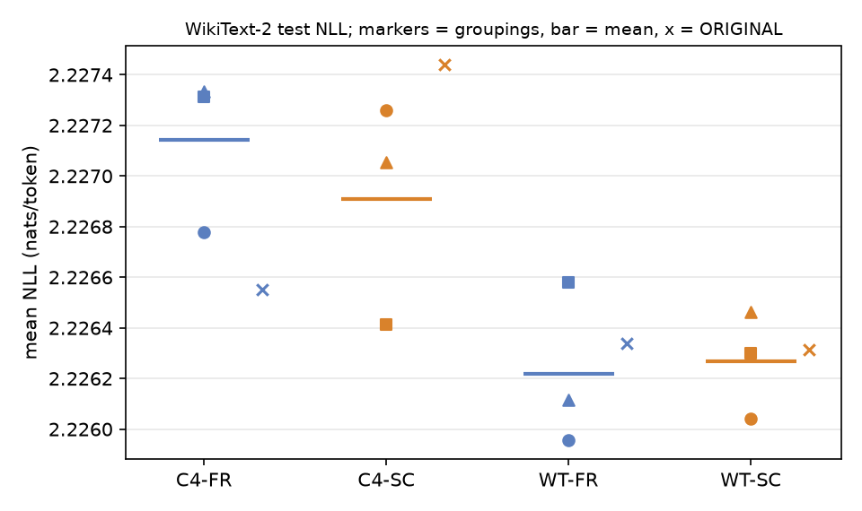
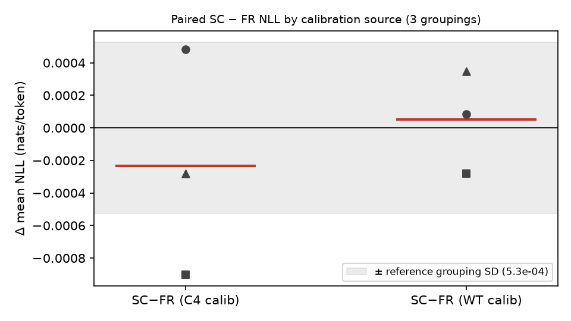
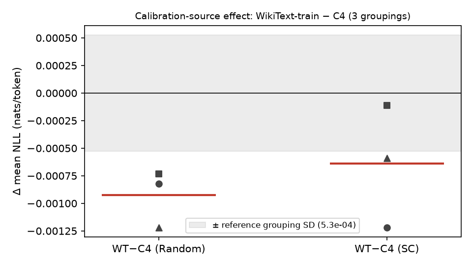
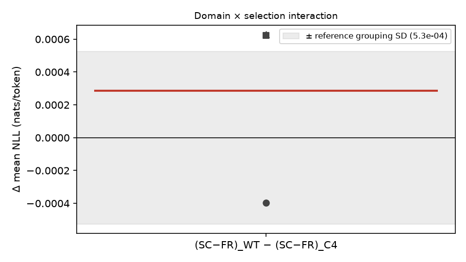
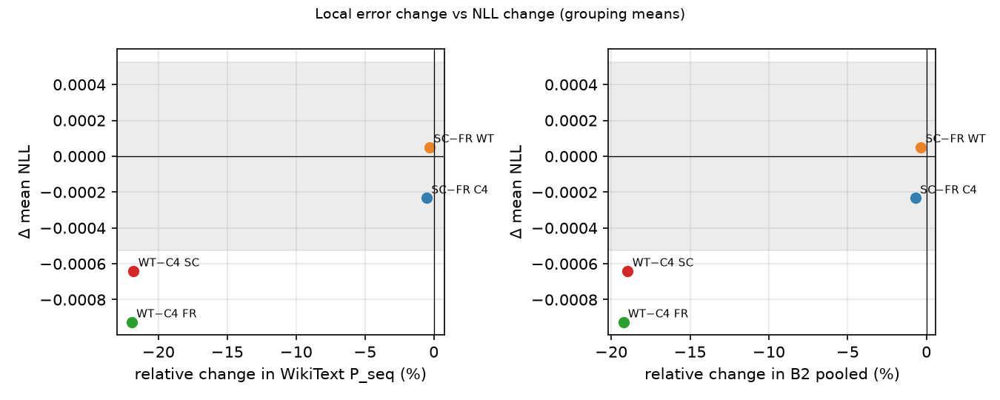

# Calibration-domain ablation: C4 vs WikiText-2-train calibration (selection seed 0)

2 × 2 design (calibration source × {Full Random, Shared Covariance-aware}), B = 128, GPTQ 4-bit g128 act-order percdamp 1.0 on the routed experts of layers 1/8/16/23. Primary outcome: mean NLL on the frozen 128 × 512 WikiText-2 test windows (partial model, sequential forward). Protocol sha `9c817814f5456d9a`, frozen before any new GPU result.

## Data and selections

- WikiText-2 train: 2,518,423 tokens → 4,918 complete 512-token windows; pool = 2000 sampled with seed 20261117 (token sha `70819f9c598aeec4`).
- Leakage: exact test-window matches 0; test 32-grams found in the pool 0 / 61568; validation 32-gram overlap 0.078 %.
- WT warm start (same convention as C4): 32 of 493 typical∩random-half sequences, hash `cf4d20c0a54852bf`. WT-FR `1f9e71589c56a670`, WT-SC `bbca7a1f30789cf8`; FR/SC overlap 35 of 128 (32 warm).
- WT covariance-sketch objective J (WT pool reference): warm 0.3264, FR 0.1651, SC 0.1246 (53 accepted swaps; deterministic rerun identical True).
- WT-FR exposure: median 4217 tokens/expert (min 1136), set routing JS 1.64e-04, mean sequence atypicality d 0.289.
- WT-SC exposure: median 4200 tokens/expert (min 1158), set routing JS 4.42e-05, mean sequence atypicality d 0.290.

## Per configuration

BF16 reference: mean NLL 2.223227, PPL 9.2371 (reproduces the stored baseline: True; B2 = 0 with original weights: True).

| config | mean NLL | PPL | NLL − BF16 | C4 test recon | WikiText P_seq | B2 pooled | B2 layer-eq | install ok | reproduces stored |
|---|---|---|---|---|---|---|---|---|---|
| C4:FR:ORIG | 2.226552 | 9.2679 | +0.003325 | 0.004610 | 5.20118e-03 | 1.41825e-02 | 1.12763e-02 | True | True |
| C4:SC:ORIG | 2.227439 | 9.2761 | +0.004212 | 0.004579 | 5.17470e-03 | 1.40863e-02 | 1.12008e-02 | True | — |
| WT:FR:ORIG | 2.226340 | 9.2659 | +0.003113 | 0.005319 | 4.06131e-03 | 1.14701e-02 | 8.92980e-03 | True | — |
| WT:SC:ORIG | 2.226315 | 9.2657 | +0.003089 | 0.005288 | 4.04696e-03 | 1.14508e-02 | 8.95891e-03 | True | — |
| C4:FR:G20261111 | 2.226778 | 9.2699 | +0.003551 | 0.004609 | 5.20154e-03 | 1.42119e-02 | 1.12550e-02 | True | True |
| C4:SC:G20261111 | 2.227260 | 9.2744 | +0.004033 | 0.004578 | 5.17545e-03 | 1.41032e-02 | 1.12169e-02 | True | True |
| WT:FR:G20261111 | 2.225956 | 9.2623 | +0.002729 | 0.005318 | 4.06054e-03 | 1.14741e-02 | 8.95645e-03 | True | — |
| WT:SC:G20261111 | 2.226042 | 9.2631 | +0.002815 | 0.005288 | 4.04673e-03 | 1.14278e-02 | 8.94106e-03 | False | — |
| C4:FR:G20261112 | 2.227314 | 9.2749 | +0.004087 | 0.004610 | 5.20147e-03 | 1.41985e-02 | 1.12728e-02 | True | True |
| C4:SC:G20261112 | 2.226413 | 9.2666 | +0.003186 | 0.004579 | 5.17534e-03 | 1.40999e-02 | 1.12454e-02 | True | True |
| WT:FR:G20261112 | 2.226581 | 9.2681 | +0.003354 | 0.005319 | 4.06007e-03 | 1.14676e-02 | 8.93855e-03 | True | — |
| WT:SC:G20261112 | 2.226301 | 9.2655 | +0.003074 | 0.005288 | 4.04747e-03 | 1.14220e-02 | 8.89873e-03 | True | — |
| C4:FR:G20261113 | 2.227335 | 9.2751 | +0.004108 | 0.004609 | 5.20183e-03 | 1.41831e-02 | 1.12544e-02 | True | True |
| C4:SC:G20261113 | 2.227053 | 9.2725 | +0.003826 | 0.004579 | 5.17512e-03 | 1.40969e-02 | 1.12083e-02 | True | True |
| WT:FR:G20261113 | 2.226116 | 9.2638 | +0.002889 | 0.005319 | 4.06105e-03 | 1.14627e-02 | 8.94533e-03 | True | — |
| WT:SC:G20261113 | 2.226462 | 9.2670 | +0.003236 | 0.005289 | 4.04745e-03 | 1.14352e-02 | 8.92349e-03 | True | — |

NLL SD over the 3 groupings per cell: C4-FR 3.16e-04, C4-SC 4.42e-04, WT-FR 3.24e-04, WT-SC 2.12e-04. Prespecified reference SD (C4 SC−FR paired ΔNLL over the 5 SC E3 groupings, RMS over seeds 0–2): 5.26e-04.

## Effects (3 calibration groupings; ORIGINAL extraction shown separately)

NLL rows are absolute differences (nats/token); local-metric rows are relative changes. Negative = the first term has lower error. Interaction = (SC−FR)_WT − (SC−FR)_C4.

**mean NLL (nats/token)**

| effect | per grouping | mean | SD | min / max | sign (−/+) | ORIGINAL | mean / ref SD | label |
|---|---|---|---|---|---|---|---|---|
| SC − FR, C4 calib | +0.000482 / -0.000901 / -0.000282 | -0.000234 | 6.93e-04 | -0.000901 / +0.000482 | 2/1 | +0.000887 | -0.44 | NOT-DISTINGUISHABLE |
| SC − FR, WT calib | +0.000086 / -0.000279 / +0.000346 | +0.000051 | 3.14e-04 | -0.000279 / +0.000346 | 1/2 | -0.000024 | +0.10 | NOT-DISTINGUISHABLE |
| WT − C4, Random | -0.000822 / -0.000733 / -0.001219 | -0.000925 | 2.59e-04 | -0.001219 / -0.000733 | 3/0 | -0.000212 | -1.76 | CONSISTENT-NEGATIVE |
| WT − C4, SC | -0.001218 / -0.000111 / -0.000591 | -0.000640 | 5.55e-04 | -0.001218 / -0.000111 | 3/0 | -0.001123 | -1.22 | CONSISTENT-NEGATIVE |
| interaction | -0.000396 / +0.000622 / +0.000629 | +0.000285 | 5.90e-04 | -0.000396 / +0.000629 | 1/2 | -0.000911 | +0.54 | NOT-DISTINGUISHABLE |

**B2 pooled**

| effect | per grouping | mean | SD | min / max | sign (−/+) | ORIGINAL |
|---|---|---|---|---|---|---|
| SC − FR, C4 calib | -0.76 % / -0.69 % / -0.61 % | -0.69 % | 0.08 % | -0.76 % / -0.61 % | 3/0 | -0.68 % |
| SC − FR, WT calib | -0.40 % / -0.40 % / -0.24 % | -0.35 % | 0.09 % | -0.40 % / -0.24 % | 3/0 | -0.17 % |
| WT − C4, Random | -19.26 % / -19.23 % / -19.18 % | -19.23 % | 0.04 % | -19.26 % / -19.18 % | 3/0 | -19.13 % |
| WT − C4, SC | -18.97 % / -18.99 % / -18.88 % | -18.95 % | 0.06 % | -18.99 % / -18.88 % | 3/0 | -18.71 % |
| interaction | +0.36 % / +0.30 % / +0.37 % | +0.34 % | 0.04 % | +0.30 % / +0.37 % | 0/3 | +0.51 % |

**B2 layer-equal**

| effect | per grouping | mean | SD | min / max | sign (−/+) | ORIGINAL |
|---|---|---|---|---|---|---|
| SC − FR, C4 calib | -0.34 % / -0.24 % / -0.41 % | -0.33 % | 0.08 % | -0.41 % / -0.24 % | 3/0 | -0.67 % |
| SC − FR, WT calib | -0.17 % / -0.45 % / -0.24 % | -0.29 % | 0.14 % | -0.45 % / -0.17 % | 3/0 | +0.33 % |
| WT − C4, Random | -20.42 % / -20.71 % / -20.52 % | -20.55 % | 0.14 % | -20.71 % / -20.42 % | 3/0 | -20.81 % |
| WT − C4, SC | -20.29 % / -20.87 % / -20.38 % | -20.51 % | 0.31 % | -20.87 % / -20.29 % | 3/0 | -20.02 % |
| interaction | +0.17 % / -0.20 % / +0.17 % | +0.04 % | 0.21 % | -0.20 % / +0.17 % | 1/2 | +1.00 % |

**WikiText P_seq**

| effect | per grouping | mean | SD | min / max | sign (−/+) | ORIGINAL |
|---|---|---|---|---|---|---|
| SC − FR, C4 calib | -0.50 % / -0.50 % / -0.51 % | -0.51 % | 0.01 % | -0.51 % / -0.50 % | 3/0 | -0.51 % |
| SC − FR, WT calib | -0.34 % / -0.31 % / -0.33 % | -0.33 % | 0.02 % | -0.34 % / -0.31 % | 3/0 | -0.35 % |
| WT − C4, Random | -21.94 % / -21.94 % / -21.93 % | -21.94 % | 0.01 % | -21.94 % / -21.93 % | 3/0 | -21.92 % |
| WT − C4, SC | -21.81 % / -21.79 % / -21.79 % | -21.80 % | 0.01 % | -21.81 % / -21.79 % | 3/0 | -21.79 % |
| interaction | +0.16 % / +0.19 % / +0.18 % | +0.18 % | 0.02 % | +0.16 % / +0.19 % | 0/3 | +0.16 % |

**C4 test reconstruction**

| effect | per grouping | mean | SD | min / max | sign (−/+) | ORIGINAL |
|---|---|---|---|---|---|---|
| SC − FR, C4 calib | -0.67 % / -0.66 % / -0.66 % | -0.66 % | 0.00 % | -0.67 % / -0.66 % | 3/0 | -0.67 % |
| SC − FR, WT calib | -0.58 % / -0.59 % / -0.57 % | -0.58 % | 0.01 % | -0.59 % / -0.57 % | 3/0 | -0.59 % |
| WT − C4, Random | +15.39 % / +15.40 % / +15.39 % | +15.39 % | 0.00 % | +15.39 % / +15.40 % | 0/3 | +15.39 % |
| WT − C4, SC | +15.49 % / +15.48 % / +15.50 % | +15.49 % | 0.01 % | +15.48 % / +15.50 % | 0/3 | +15.49 % |
| interaction | +0.09 % / +0.07 % / +0.09 % | +0.08 % | 0.01 % | +0.07 % / +0.09 % | 0/3 | +0.08 % |

Per-layer B2 per configuration: `per_layer_b2.csv`.

## Checks

- install_ok: 15/16 configurations pass every installer check; flagged: WT:SC:G20261111.
  - WT:SC:G20261111: check expert L1/e0 installed-vs-E3 FP32 output deviation 0.00557 > tolerance 0.00510 (weights bitwise = BF16(W_q): True; quant effect 0.032; 106 tokens). Every structural check passed (240 quantized, 0 RTN, untouched params unchanged, restored pristine), so the result is kept and flagged, not dropped; the frozen tolerance was not changed.
- All configurations: RTN fallbacks [0]; non-target parameters changed [0]; non-finite targets [0]; scored tokens [65408].
- C4 re-runs reproduce the stored results bitwise (installed sha, per-expert recon, per-window NLL; C4-FR ORIG also the MVP B B2 sums): {'C4:FR:G20261111': True, 'C4:FR:G20261112': True, 'C4:FR:G20261113': True, 'C4:FR:ORIG': True, 'C4:SC:G20261111': True, 'C4:SC:G20261112': True, 'C4:SC:G20261113': True}.
- Identical evaluation windows (sha `e646cf7ce463f3de`) and identical BF16 capture for every configuration; GPTQ settings from the frozen config.
- WT selections, routing and sketches use WT-train pool rows only; SC sketch counts equal the WT routing profile (sketch-stage check).
