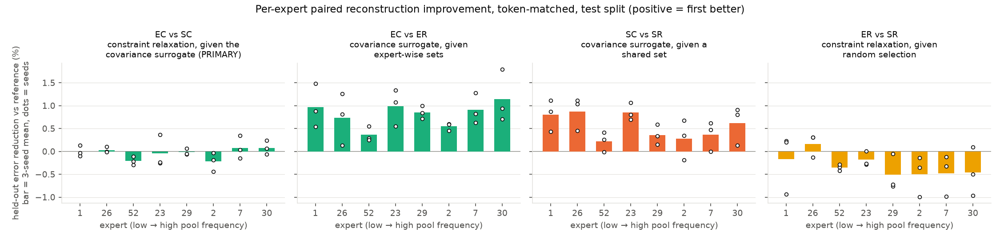
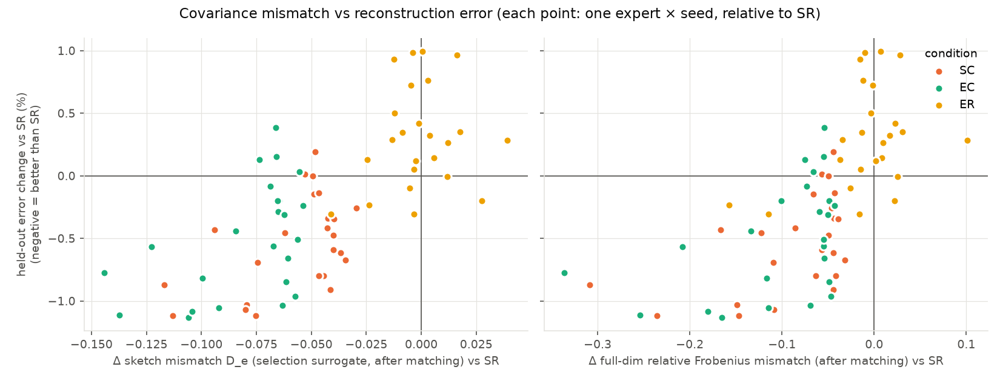

# Expert-wise Activation Calibration MVP — summary

Qwen1.5-MoE-A2.7B, layer 16, 8 experts, candidate pool = 2,000 C4 sequences (rows 0-1999 of `~/moe_cache`), seq len 512, B = 128, seeds 0/1/2. GPTQ 4-bit / g128 / act-order / percdamp 1.0 (`quantize_expert` unchanged). Primary metric: E3 per-sequence relative reconstruction error (gate+up+down) on held-out test rows 2128-2255, mean over sequences, then mean over the 8 experts. Secondary: confirmation split (256 seqs). **Isolated expert reconstruction only — no full-model PPL, no inference-efficiency claim.**

All correctness checks passed: **True**; smoke seed 0 reproduced bit-for-bit by final seed 0: **True**

Experts (pool-frequency rank 0 = rarest of 60): 1 (rank 0, 51,392 pool tokens), 26 (rank 8, 63,026 pool tokens), 52 (rank 17, 63,975 pool tokens), 23 (rank 25, 64,888 pool tokens), 29 (rank 34, 67,866 pool tokens), 2 (rank 42, 71,747 pool tokens), 7 (rank 51, 76,315 pool tokens), 30 (rank 59, 84,253 pool tokens)

## 1. Mean reconstruction error (token-matched, primary)

**test** split

| condition | seed 0 | seed 1 | seed 2 | 3-seed mean |
|---|---|---|---|---|
| SR | 0.005123 | 0.005136 | 0.005138 | **0.005133** |
| SC | 0.005108 | 0.005101 | 0.005106 | **0.005105** |
| EC | 0.005108 | 0.005103 | 0.005110 | **0.005107** |
| ER | 0.005152 | 0.005153 | 0.005140 | **0.005148** |

**confirm** split

| condition | seed 0 | seed 1 | seed 2 | 3-seed mean |
|---|---|---|---|---|
| SR | 0.005067 | 0.005115 | 0.005091 | **0.005091** |
| SC | 0.005061 | 0.005055 | 0.005063 | **0.005060** |
| EC | 0.005058 | 0.005059 | 0.005066 | **0.005061** |
| ER | 0.005108 | 0.005107 | 0.005105 | **0.005107** |

## 2. Paired relative improvements by seed (positive = first condition better)

r_e = (err_Y − err_X)/err_Y per expert, averaged over the 8 experts. Pre-registered rule: *consistent* = positive in all 3 seeds AND ≥ 6/8 experts improved on the seed average; *material* = also ≥ 0.5 %.

**matched / test**

| comparison | what it isolates | seed 0 | seed 1 | seed 2 | mean ± sd | experts improved | expert×seed wins | verdict |
|---|---|---|---|---|---|---|---|---|
| EC vs SC | constraint relaxation, given the covariance surrogate (PRIMARY) | +0.00 % | -0.03 % | -0.09 % | -0.04 % ± 0.05 | 4/8 | 8/24 | INCONSISTENT / NO RELIABLE EFFECT |
| EC vs ER | covariance surrogate, given expert-wise sets | +0.86 % | +0.99 % | +0.59 % | +0.81 % ± 0.21 | 8/8 | 24/24 | CONSISTENT-IMPROVEMENT (material, >= 0.5 %) |
| SC vs SR | covariance surrogate, given a shared set | +0.29 % | +0.70 % | +0.65 % | +0.55 % ± 0.22 | 8/8 | 21/24 | CONSISTENT-IMPROVEMENT (material, >= 0.5 %) |
| ER vs SR | constraint relaxation, given random selection | -0.57 % | -0.33 % | -0.02 % | -0.31 % ± 0.27 | 1/8 | 6/24 | CONSISTENT-DEGRADATION (below 0.5 %) |

**matched / confirm**

| comparison | what it isolates | seed 0 | seed 1 | seed 2 | mean ± sd | experts improved | expert×seed wins | verdict |
|---|---|---|---|---|---|---|---|---|
| EC vs SC | constraint relaxation, given the covariance surrogate (PRIMARY) | +0.09 % | -0.09 % | -0.07 % | -0.03 % ± 0.10 | 4/8 | 11/24 | INCONSISTENT / NO RELIABLE EFFECT |
| EC vs ER | covariance surrogate, given expert-wise sets | +1.02 % | +0.96 % | +0.75 % | +0.91 % ± 0.14 | 8/8 | 24/24 | CONSISTENT-IMPROVEMENT (material, >= 0.5 %) |
| SC vs SR | covariance surrogate, given a shared set | +0.10 % | +1.18 % | +0.58 % | +0.62 % ± 0.54 | 8/8 | 21/24 | CONSISTENT-IMPROVEMENT (material, >= 0.5 %) |
| ER vs SR | constraint relaxation, given random selection | -0.85 % | +0.14 % | -0.25 % | -0.32 % ± 0.50 | 1/8 | 7/24 | INCONSISTENT / NO RELIABLE EFFECT |

**unmatched / test** — secondary, token quantity NOT controlled

| comparison | what it isolates | seed 0 | seed 1 | seed 2 | mean ± sd | experts improved | expert×seed wins | verdict |
|---|---|---|---|---|---|---|---|---|
| EC vs SC | constraint relaxation, given the covariance surrogate (PRIMARY) | +0.22 % | +0.25 % | +0.21 % | +0.23 % ± 0.02 | 8/8 | 22/24 | CONSISTENT-IMPROVEMENT (below 0.5 % materiality) |
| EC vs ER | covariance surrogate, given expert-wise sets | +1.24 % | +1.33 % | +1.06 % | +1.21 % ± 0.14 | 8/8 | 24/24 | CONSISTENT-IMPROVEMENT (material, >= 0.5 %) |
| SC vs SR | covariance surrogate, given a shared set | +0.43 % | +0.69 % | +0.79 % | +0.64 % ± 0.19 | 8/8 | 23/24 | CONSISTENT-IMPROVEMENT (material, >= 0.5 %) |
| ER vs SR | constraint relaxation, given random selection | -0.60 % | -0.39 % | -0.06 % | -0.35 % ± 0.28 | 1/8 | 5/24 | CONSISTENT-DEGRADATION (below 0.5 %) |

Interaction (relaxation effect under the surrogate minus under random selection), matched/test, per seed: +0.58 %, +0.30 %, -0.06 %

## 3. Per-expert differences (matched, test; 3-seed mean, seeds in brackets)

| expert (rank) | k_e mean | EC vs SC | EC vs ER | SC vs SR | ER vs SR |
|---|---|---|---|---|---|
| 1 (0) | 3,070 | +0.00 % [+0.1, -0.1, -0.0] | +0.97 % [+1.5, +0.5, +0.9] | +0.81 % [+0.4, +0.9, +1.1] | -0.17 % [-0.9, +0.2, +0.2] |
| 26 (8) | 3,933 | +0.03 % [-0.0, +0.1, -0.0] | +0.74 % [+0.8, +1.3, +0.1] | +0.87 % [+1.1, +1.0, +0.5] | +0.16 % [+0.3, -0.1, +0.3] |
| 52 (17) | 3,966 | -0.21 % [-0.1, -0.2, -0.3] | +0.36 % [+0.3, +0.5, +0.3] | +0.22 % [-0.0, +0.4, +0.3] | -0.35 % [-0.4, -0.3, -0.3] |
| 23 (25) | 4,154 | -0.04 % [+0.4, -0.3, -0.2] | +0.99 % [+1.3, +1.1, +0.6] | +0.85 % [+0.7, +1.1, +0.8] | -0.18 % [-0.3, -0.3, +0.0] |
| 29 (34) | 4,382 | -0.02 % [-0.1, -0.1, +0.1] | +0.85 % [+0.8, +1.0, +0.7] | +0.36 % [+0.1, +0.3, +0.6] | -0.51 % [-0.8, -0.7, -0.1] |
| 2 (42) | 4,470 | -0.22 % [-0.2, -0.0, -0.4] | +0.55 % [+0.6, +0.5, +0.6] | +0.27 % [-0.2, +0.3, +0.7] | -0.49 % [-1.0, -0.1, -0.4] |
| 7 (51) | 4,760 | +0.08 % [-0.2, +0.4, +0.0] | +0.91 % [+0.8, +1.3, +0.6] | +0.36 % [-0.0, +0.6, +0.5] | -0.48 % [-1.0, -0.3, -0.1] |
| 30 (59) | 5,341 | +0.08 % [+0.1, -0.1, +0.2] | +1.14 % [+0.7, +1.8, +0.9] | +0.62 % [+0.1, +0.9, +0.8] | -0.46 % [-0.5, -1.0, +0.1] |

## 4. Covariance mismatch before / after token matching (mean over experts × seeds)

Sketch = the 64-d selection surrogate D_e; full = mean over gu/down of the full-dimensional relative Frobenius distance of the token-normalized Hessian to the full-pool Hessian (diagnostic only, never used for selection). Pre = all routed tokens of the selected sequences; post = the k_e matched tokens actually given to GPTQ.

| condition | sketch pre | sketch post | full pre | full post |
|---|---|---|---|---|
| SR | 0.1775 | 0.1785 | 0.4257 | 0.4289 |
| SC | 0.1189 | 0.1211 | 0.3342 | 0.3392 |
| EC | 0.0930 | 0.0995 | 0.3140 | 0.3263 |
| ER | 0.1774 | 0.1776 | 0.4205 | 0.4214 |

Spearman(Δ mismatch vs SR, Δ error vs SR) over expert × seed × {SC, EC, ER} (n = 72): sketch post ρ = +0.691 (p = 1.82e-11); full post ρ = +0.708 (p = 3.4e-12).

## 5. Routed-token counts and matched quotas

| expert | seed 0: SR / SC / EC / ER → k_e | seed 1: SR / SC / EC / ER → k_e | seed 2: SR / SC / EC / ER → k_e |
|---|---|---|---|
| 1 | 3,100 / 3,514 / 3,865 / 3,166 → **3,100** | 3,477 / 3,418 / 3,662 / 3,003 → **3,003** | 3,201 / 3,436 / 3,711 / 3,107 → **3,107** |
| 26 | 4,053 / 4,140 / 4,382 / 3,999 → **3,999** | 3,946 / 4,092 / 4,386 / 4,147 → **3,946** | 4,050 / 4,129 / 4,431 / 3,854 → **3,854** |
| 52 | 3,978 / 4,146 / 4,615 / 3,954 → **3,954** | 4,105 / 4,047 / 4,711 / 3,954 → **3,954** | 3,991 / 4,154 / 4,737 / 4,269 → **3,991** |
| 23 | 4,263 / 4,197 / 4,741 / 4,058 → **4,058** | 4,272 / 4,333 / 4,566 / 4,282 → **4,272** | 4,249 / 4,263 / 4,738 / 4,132 → **4,132** |
| 29 | 4,246 / 4,604 / 4,798 / 4,340 → **4,246** | 4,451 / 4,511 / 4,686 / 4,576 → **4,451** | 4,523 / 4,449 / 4,716 / 4,464 → **4,449** |
| 2 | 4,589 / 4,649 / 5,141 / 4,531 → **4,531** | 4,779 / 4,515 / 5,119 / 4,660 → **4,515** | 4,364 / 4,555 / 5,029 / 4,547 → **4,364** |
| 7 | 4,877 / 4,968 / 5,200 / 4,859 → **4,859** | 4,644 / 5,135 / 5,248 / 4,937 → **4,644** | 4,930 / 4,954 / 5,459 / 4,778 → **4,778** |
| 30 | 5,550 / 5,535 / 5,737 / 5,392 → **5,392** | 5,300 / 5,573 / 5,559 / 5,372 → **5,300** | 5,514 / 5,584 / 5,935 / 5,330 → **5,330** |

## 6. Source sequences and effective diversity (mean over experts × seeds)

Effective diversity = inverse Simpson 1/Σ p_s² of the per-sequence token shares.

| condition | distinct seqs (matched) | eff. diversity (matched) | distinct seqs (all tokens) | eff. diversity (all tokens) | discarded token fraction |
|---|---|---|---|---|---|
| SR | 128.0 | 111.0 | 128.0 | 111.2 | 2.2 % |
| SC | 128.0 | 115.8 | 128.0 | 115.9 | 4.5 % |
| EC | 128.0 | 120.3 | 128.0 | 120.7 | 11.5 % |
| ER | 128.0 | 111.1 | 128.0 | 111.2 | 1.4 % |

## 7. Shared vs expert-wise selection overlap

| seed | union SR | union SC | union EC | union ER | EC↔SC Jaccard | EC pairwise Jaccard | ER pairwise Jaccard | sequences replayed (all conditions) |
|---|---|---|---|---|---|---|---|---|
| 0 | 128 | 128 | 787 | 819 | 0.069 | 0.042 | 0.034 | 1349 |
| 1 | 128 | 128 | 771 | 827 | 0.063 | 0.045 | 0.033 | 1346 |
| 2 | 128 | 128 | 771 | 820 | 0.074 | 0.049 | 0.032 | 1336 |

## 8. Cost

* Sketch pass (2,000 pool sequences, 8 experts, gu+down sketches + full-dim reference): **66 s** vs plain layer replay 59 s and routing-only Profiler 117 s (the existing Profiler routing pass is slower than both because of its per-expert Python bookkeeping) → extra profiling over a plain replay ≈ 7 s (+11 %). Peak GPU 2.03 GB, peak RSS 8.7 GB.
* Sketch storage: 533 MB of per-(seq, expert, proj) sketches for 8 experts (file incl. full-dim diagnostic references: 730 MB, outside the repo). Scales linearly in experts: ≈ 3995 MB per layer for all 60.

| seed | selection CPU s | union replayed | capture s | s/seq | held-out capture s | GPTQ+eval s (64 quantizations) | peak GPU capture GB | peak GPU GPTQ GB |
|---|---|---|---|---|---|---|---|---|
| 0 | 55.7 | 1349 | 33 | 0.024 | 68 | 122 | 3.41 | 2.34 |
| 1 | 62.2 | 1346 | 33 | 0.025 | 91 | 148 | 3.41 | 2.34 |
| 2 | 57.7 | 1336 | 32 | 0.024 | 85 | 130 | 3.41 | 2.34 |

Acquisition-cost note: SR/SC need 128 sequence forwards; EC/ER need the union of their per-expert sets (table 7) for just 8 experts — with all 60 experts the union approaches the whole pool.

## Correctness checks

Per seed: `exactly_8_experts`, `sets_of_128_distinct`, `matched_counts_identical_across_conditions`, `unmatched_counts_equal_selection`, `natural_routing_and_gu_down_alignment`, `replay_counts_equal_sketch`, `rows_in_range`, `per_seq_sketch_reproduced`, `pre_matching_sketch_equals_selection_time`, `matching_plan_deterministic`, `selection_deterministic`, `objective_monotone`, `selection_uses_pool_only`, `eval_rows_disjoint_from_pool`, `weights_unchanged`, `same_eval_activations_all_conditions`, `frozen_code_unchanged` — all True in every seed: **True**. Alignment checks per seed: 10792, 10768, 10688. Sketch pass: `outputs_identical_with_hooks`=True, `counts_equal_routing_profile_and_profiler`=True, `weights_unchanged`=True, `sketch_finite`=True, `full_ref_finite`=True, `passed`=True.

## Interpretation

**Question: does expert-wise calibration improve reconstruction over shared-sequence calibration after controlling
for per-expert routed-token counts? — No.** Under the same covariance surrogate, letting each expert choose its own
128 sequences (EC) gives the same held-out error as one shared, covariance-selected set (SC):
−0.04 % ± 0.05 (test) and −0.03 % ± 0.10 (confirmation). Only 4/8 experts improve and the sign changes across seeds.
EC also costs about 6× the sequence acquisition (a union of 771–787 sequences for 8 experts vs. 128).

**Where the gains come from.** The 2 × 2 design separates the two factors:

| factor | comparison | matched test | matched confirm |
|---|---|---|---|
| covariance-aware selection (shared) | SC vs SR | **+0.55 %**, 8/8 experts, 3/3 seeds | +0.62 %, 8/8 |
| covariance-aware selection (expert-wise) | EC vs ER | **+0.81 %**, 8/8 experts, 24/24 expert×seed | +0.91 %, 8/8 |
| removing the shared constraint (surrogate) | EC vs SC | −0.04 % (null) | −0.03 % (null) |
| removing the shared constraint (random) | ER vs SR | −0.31 % (1/8 experts) | −0.32 % (mixed) |

The improvement comes entirely from **covariance-aware selection**, not from relaxing the shared-sequence
constraint. All effects are small: under 1 % relative, with absolute errors around 5.1e-3. Part of the EC-vs-ER gain
comes from ER sitting slightly *above* SR. The ER-vs-SR deficit should not be over-read: each seed has only one SR
draw shared by all 8 experts, so the shared conditions supply just 3 independent draws (a 1-in-8 chance that all 3
land on the same side of ER by luck).

**Token quantity versus selection quality.** Without token matching (secondary analysis), EC beats SC consistently,
by +0.23 % with 8/8 experts. EC's objective prefers sequences that route more tokens to the expert: it carries 4–14 %
more tokens than SC, and 11.5 % of its tokens are discarded by matching (SC: 4.5 %). Once counts are matched, that
advantage disappears. **The apparent expert-wise benefit is a per-expert token-quantity effect, not a selection-quality
effect.**

**Surrogate improvement is not quantizer improvement.** EC lowers the 64-d sketch mismatch relative to SC in **24/24**
expert×seed cases (0.121 → 0.0995 after matching, −18 %) and lowers the full-dimensional mismatch on average
(0.339 → 0.326). Neither predicts the EC-vs-SC error change: Spearman ρ = −0.02 (sketch, p = 0.91) and −0.25 (full-dim,
p = 0.23), n = 24. The pooled ρ ≈ +0.7 between mismatch and error in §4 comes from the large gap between random and
covariance-aware sets. Within the covariance-aware regime, further mismatch reduction buys nothing measurable.

**Separating the confounds the protocol asked about:**
* *Relaxing the shared constraint*: null after matching (EC vs SC).
* *Covariance-aware surrogate*: the only factor with a consistent, material effect, under both shared and expert-wise
  sets.
* *Larger union of unique sequences*: EC reads ~780 distinct sequences in total (ER ~820). Each expert still sees
  exactly 128 sequences, and its effective source diversity is only mildly higher (inverse Simpson 120 vs 116 for SC).
  The larger union is a cost, not a measured benefit.
* *Per-expert token budget versus global sequence budget*: k_e matches tokens per expert, but EC/ER need a much larger
  global acquisition budget (for all 60 experts the union would approach the whole pool). Even with that budget
  advantage, EC does not beat SC.

**Limitations.** One layer (L16), 8 of 60 experts, B = 128, 3 allocation seeds, and an isolated-expert reconstruction
metric only: no full-model PPL and no inference-efficiency claim. Layer 16's routing is fairly balanced (51k–84k pool
tokens per expert), and the result may differ in layers with rarer experts or at low budgets. The reference covariance
is the candidate pool's own, not the evaluation distribution's. The selection optimizer is a heuristic (stochastic
greedy plus swaps) on a 64-d sketch. The test rows and confirmation split were inspected in earlier studies, but
neither was used for any selection or setting here; all settings were frozen after the seed-0 smoke run, which the
final seed-0 run reproduced bit-for-bit.

**Recommendation.** Do not pursue expert-wise sequence selection as a replacement for shared-sequence E3. If anything
here is worth carrying forward, it is the *shared* covariance-aware objective (SC: +0.55–0.62 % over random at
unchanged acquisition cost). It should be tested against the existing fixed-budget E3 strategies before any claim is
made, since it has not been compared with them here.

