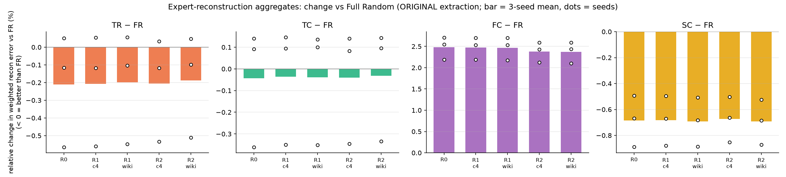
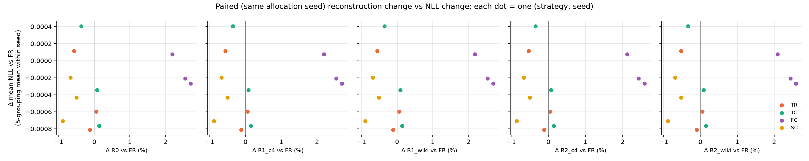

# Loss-alignment MVP A — expert-reconstruction aggregations vs model-level NLL

No GPTQ was re-run. Every number comes from stored per-expert E3 test errors and stored partial-model WikiText-2 NLLs; only the expert aggregation weights are new. Reference weights are FIXED and identical for every strategy (never computed from a strategy's own calibration set); layers are always weighted equally.

## Metric definitions

- `E[L,e]`: stored `per_expert.mean` = mean over the 128 held-out C4 test sequences of the per-sequence relative squared gate/up/down projection error. Unchanged.
- **R0** = mean_L mean_e E[L,e] (project macro metric).
- **R1_c4** = mean_L Σ_e p[L,e] E[L,e], p = routed-token frequency over the 2,000-sequence C4 candidate pool (`routing_profile_v2.npz`).  **R1_wiki**: same with the BF16 model's routing on the 128 frozen WikiText-2 PPL windows.
- **R2** = mean_L Σ_e a[L,e] E[L,e], a ∝ Σ_t 1[e ∈ top-4(t)] · w_{t,e}², w = the router weight the BF16 model actually applies (FP32 softmax over 60 experts, top-4, **no renormalization** since `norm_topk_prob=False`, then cast to BF16). R2_c4 from a layer replay of the C4 pool; R2_wiki from the 128 WikiText windows. *Heuristic*: ignores expert output scale, the nonlinearity and cross-expert interaction.

## Checks

- R0 reproduces every stored macro reconstruction (max rel diff 1.9e-16).
- R1_c4 reproduces E3's stored `recon_usage_weighted` for the 12 FR/TR/FC/TC runs (max rel diff 1.9e-16); p equals the stored profile p: True.
- All weight rows sum to 1: {'R0': True, 'R1_c4': True, 'R1_wiki': True, 'R2_wiki': True, 'R2_c4': True}. Same number of scored NLL tokens everywhere: True.
- WikiText routing: 128 windows × 512 tokens, top-4, ids valid True, no repeats True, per-token sum of the 4 weights in [0.092, 0.983] (< 1, as expected without renormalization).
- C4 router replay reproduces the stored per-sequence routing counts exactly (`c4_router_stats.json`).

Weight concentration (effective number of experts per layer, L1/L8/L16/L23; uniform = 60):

| weights | L1 | L8 | L16 | L23 | max weight ÷ uniform (per layer) |
|---|---|---|---|---|---|
| R0 | 60.0 | 60.0 | 60.0 | 60.0 | 1.00 / 1.00 / 1.00 / 1.00 |
| R1_c4 | 59.8 | 59.7 | 59.4 | 59.2 | 1.22 / 1.14 / 1.23 / 1.38 |
| R1_wiki | 56.7 | 56.0 | 57.2 | 47.9 | 1.92 / 2.19 / 1.89 / 3.81 |
| R2_c4 | 49.2 | 56.8 | 50.9 | 45.3 | 2.57 / 1.76 / 2.85 / 2.94 |
| R2_wiki | 48.0 | 45.5 | 45.5 | 34.2 | 2.21 / 4.06 / 3.11 / 3.48 |

## 1. Aggregates per strategy (ORIGINAL extraction, 3-seed mean)

| strategy | R0 | R1_c4 | R1_wiki | R2_c4 | R2_wiki | mean NLL | PPL |
|---|---|---|---|---|---|---|---|
| FR | 0.004615 | 0.004601 | 0.004569 | 0.004572 | 0.004645 | 2.226716 | 9.2694 |
| TR | 0.004606 | 0.004592 | 0.004560 | 0.004562 | 0.004636 | 2.226603 | 9.2683 |
| FC | 0.004730 | 0.004715 | 0.004682 | 0.004680 | 0.004755 | 2.227645 | 9.2780 |
| TC | 0.004613 | 0.004600 | 0.004567 | 0.004570 | 0.004643 | 2.227054 | 9.2725 |
| SC | 0.004584 | 0.004570 | 0.004537 | 0.004541 | 0.004613 | 2.226547 | 9.2678 |

## 2. Paired change vs FR (relative; < 0 = lower error than FR)

| strategy | R0 | R1_c4 | R1_wiki | R2_c4 | R2_wiki | ΔNLL ORIGINAL per seed | ΔNLL grouped (5-grouping mean ± SD per seed) |
|---|---|---|---|---|---|---|---|
| SC | -0.68 % (-0.67 / -0.89 / -0.49) | -0.68 % (-0.67 / -0.88 / -0.50) | -0.69 % (-0.68 / -0.89 / -0.51) | -0.67 % (-0.66 / -0.85 / -0.50) | -0.69 % (-0.68 / -0.87 / -0.52) | +0.00089 / -0.00111 / -0.00028 | -0.00020 ± 0.00052 / -0.00071 ± 0.00041 / -0.00043 ± 0.00063 |
| TR | -0.21 % (+0.05 / -0.57 / -0.12) | -0.21 % (+0.05 / -0.56 / -0.12) | -0.20 % (+0.06 / -0.55 / -0.10) | -0.21 % (+0.03 / -0.53 / -0.12) | -0.19 % (+0.05 / -0.51 / -0.10) | +0.00002 / +0.00000 / -0.00036 | -0.00060 ± 0.00071 / +0.00012 ± 0.00054 / -0.00081 ± 0.00053 |
| TC | -0.04 % (+0.14 / -0.36 / +0.09) | -0.04 % (+0.15 / -0.35 / +0.09) | -0.04 % (+0.14 / -0.35 / +0.10) | -0.04 % (+0.14 / -0.35 / +0.08) | -0.03 % (+0.14 / -0.33 / +0.10) | +0.00051 / +0.00030 / +0.00021 | -0.00076 ± 0.00033 / +0.00040 ± 0.00045 / -0.00035 ± 0.00072 |
| FC | +2.48 % (+2.55 / +2.19 / +2.71) | +2.47 % (+2.53 / +2.19 / +2.70) | +2.47 % (+2.53 / +2.18 / +2.70) | +2.38 % (+2.43 / +2.12 / +2.59) | +2.37 % (+2.44 / +2.10 / +2.59) | +0.00108 / +0.00029 / +0.00141 | -0.00021 ± 0.00069 / +0.00007 ± 0.00056 / -0.00027 ± 0.00093 |

Retention of the R0 change (mean Δ_metric ÷ mean Δ_R0; 1 = unchanged by weighting, < 1 = smaller, < 0 = reversed):

| strategy | R0 | R1_c4 | R1_wiki | R2_c4 | R2_wiki | sign consistent over 3 seeds |
|---|---|---|---|---|---|---|
| SC | 1.00 | 1.00 | 1.01 | 0.98 | 1.01 | R0, R1_c4, R1_wiki, R2_c4, R2_wiki |
| TR | 1.00 | 0.99 | 0.94 | 0.98 | 0.89 |  |
| TC | 1.00 | 0.83 | 0.88 | 0.93 | 0.72 |  |
| FC | 1.00 | 1.00 | 0.99 | 0.96 | 0.96 | R0, R1_c4, R1_wiki, R2_c4, R2_wiki |

Grouping-averaged paired change (per-expert errors of the grouped runs, same study as the grouped NLL):

| strategy | R0 | R1_c4 | R1_wiki | R2_c4 | R2_wiki |
|---|---|---|---|---|---|
| SC | -0.67 / -0.89 / -0.50 % | -0.67 / -0.88 / -0.50 % | -0.68 / -0.89 / -0.52 % | -0.66 / -0.85 / -0.50 % | -0.68 / -0.88 / -0.52 % |
| TR | +0.05 / -0.57 / -0.12 % | +0.06 / -0.56 / -0.12 % | +0.06 / -0.55 / -0.11 % | +0.04 / -0.54 / -0.12 % | +0.06 / -0.52 / -0.10 % |
| TC | +0.14 / -0.36 / +0.08 % | +0.15 / -0.35 / +0.08 % | +0.14 / -0.35 / +0.09 % | +0.15 / -0.35 / +0.08 % | +0.15 / -0.34 / +0.09 % |
| FC | +2.55 / +2.19 / +2.71 % | +2.54 / +2.19 / +2.69 % | +2.54 / +2.18 / +2.69 % | +2.43 / +2.12 / +2.59 % | +2.44 / +2.09 / +2.59 % |

## 3. Where does the change sit? (per-expert relative improvement over FR, 3-seed mean, vs expert weight)

| strategy | metric weight | Spearman(improvement, weight) | mean improvement, top-quartile-weight experts | bottom quartile |
|---|---|---|---|---|
| SC | R1_c4 | -0.15 | +0.64 % | +0.77 % |
| SC | R1_wiki | +0.06 | +0.78 % | +0.76 % |
| SC | R2_c4 | -0.11 | +0.71 % | +0.83 % |
| SC | R2_wiki | -0.01 | +0.73 % | +0.78 % |
| FC | R1_c4 | +0.24 | -2.32 % | -2.71 % |
| FC | R1_wiki | +0.04 | -2.40 % | -2.56 % |
| FC | R2_c4 | +0.32 | -2.33 % | -2.87 % |
| FC | R2_wiki | +0.19 | -2.44 % | -2.69 % |

## 4. Alignment with NLL (descriptive; 12 paired (strategy, seed) deltas, 4 strategies)

| metric | Spearman(Δmetric, ΔNLL) ORIGINAL | Spearman(Δmetric, ΔNLL) grouping-averaged |
|---|---|---|
| R0 | +0.62 | -0.01 |
| R1_c4 | +0.62 | -0.01 |
| R1_wiki | +0.62 | -0.01 |
| R2_c4 | +0.62 | -0.01 |
| R2_wiki | +0.63 | -0.01 |

With 12 points that are 4 strategies × 3 seeds (not independent), no correlation here is statistically meaningful; the table only shows whether a weighting changes the ranking.

## 5. Interpretation

### What the results establish
- **Expert weighting does not change any comparison.**
  - SC keeps 98–101 % of its R0 improvement under every weighting: frequency or squared router weight, C4 or WikiText reference.
  - The improvement is negative (better) on all 3 seeds under every metric.
  - FC keeps 96–100 % of its +2.5 % penalty. TR and TC stay small and seed-inconsistent under every weighting.
- **Why:** the weights are not very concentrated, and the changes are spread evenly across experts.
  - Effective experts per layer: 59–60 (R1_c4), 48–57 (R1_wiki), 34–57 (R2).
  - SC's per-expert improvement is nearly unrelated to expert weight (Spearman −0.15 to +0.06). Top- and bottom-quartile experts improve about equally (+0.64 to +0.83 %).
  - With a broad, even change, any convex reweighting returns about the same mean.
- **The grouped runs agree:** grouping-averaged per-expert errors give the same deltas as the ORIGINAL extraction.

### What remains uncertain
- Model-level NLL differences are at noise level.
  - ORIGINAL-extraction ΔNLL for SC vs FR is mixed in sign: +0.0009 / −0.0011 / −0.0003.
  - Grouping-averaged ΔNLL is −0.0002 to −0.0007 per seed, with grouping SDs of 0.0004–0.0006 per seed.
- The Spearman values in §4 are +0.62 on ORIGINAL NLL and −0.01 after grouping averaging, identical for every weighting.
  - The +0.62 is carried by FC's ORIGINAL-extraction NLL penalty, which earlier grouping studies showed is a grouping artifact.
  - 12 points from 4 strategies × 3 seeds cannot support a correlation claim.

### Does changing expert-importance weights explain the discrepancy?
**No.** Outcome A is ruled out.
- Equal-expert aggregation does not overstate SC's improvement relative to frequency- or router-weight-aware aggregation, nor FC's penalty.
- Whatever separates reconstruction from NLL lies elsewhere: in the data the error is measured on, the nonlinearity or aggregation (MVP B), downstream propagation, or detectability.

