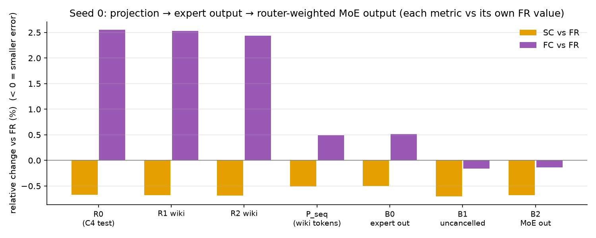
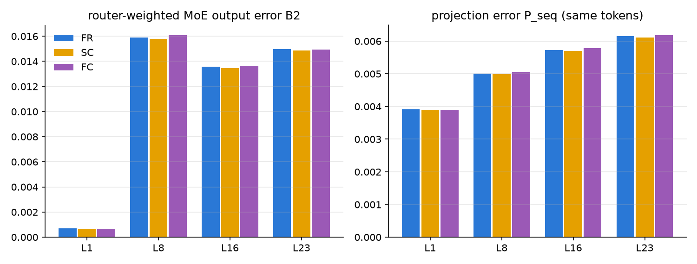
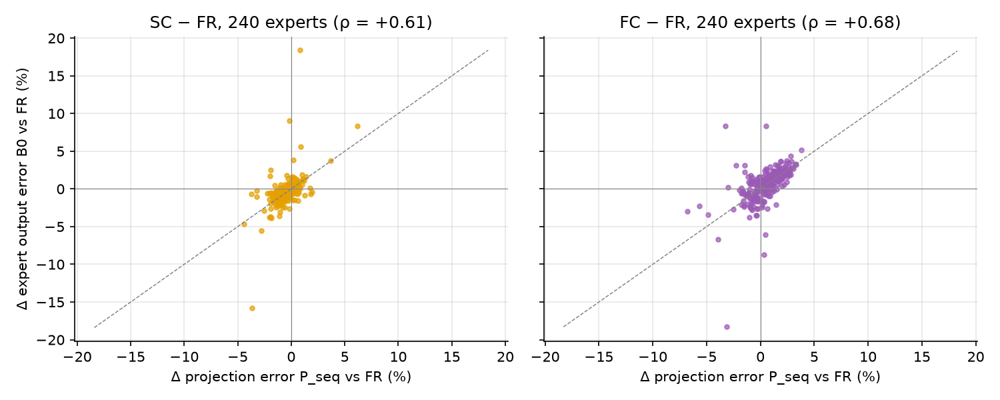

# Loss-alignment MVP B — fixed-input, fixed-routing expert-output and MoE-output error (seed 0)

FR / SC / FC effective GPTQ weights (allocation seed 0) evaluated on the BF16 model's own MoE-block inputs, top-4 routing and applied router weights at layers 1/8/16/23 for 32 frozen WikiText-2 windows (16384 tokens per layer; protocol positions [0, 1, 24, 27, 31, 32, 41, 43, 45, 46, 51, 53, 55, 64, 66, 71, 72, 73, 80, 81, 82, 88, 97, 99, 108, 109, 114, 116, 119, 121, 122, 126]). No quantized sequential forward: errors do not propagate and routing never changes, so B2 is the direct local effect of the expert weights, **not** the model-level error.

## Correctness checks

| layer | router logits = module (bitwise) | HF block re-execution = module output (bitwise) | ids = stored PPL-run routing | weights = stored | weights sum ≤ 1 | FP32 vs BF16 expert forward (rel) | tokens |
|---|---|---|---|---|---|---|---|
| L1 | True | True | True | True | True | 3.97e-03 | 16384 |
| L8 | True | True | True | True | True | 3.79e-03 | 16384 |
| L16 | True | True | True | True | True | 3.71e-03 | 16384 |
| L23 | True | True | True | True | True | 3.55e-03 | 16384 |

| run | installed sha256 = expected | untouched params unchanged | non-finite | experts changed | restored pristine |
|---|---|---|---|---|---|
| BF16 | True (`1bccfd7121080c4a`) | True (83) | 0 | 0 | True |
| FR | True (`0abe191c4bcbca24`) | True (83) | 0 | 720 | True |
| SC | True (`5d8623db0af24385`) | True (83) | 0 | 720 | True |
| FC | True (`d2592c3274f4ae2f`) | True (83) | 0 | 720 | True |

BF16 control (original weights through the same code): all error numerators exactly 0: **True**. Routed reference m_BF16 (FP32 recompute) vs the module's BF16 routed sum: rel. deviation L1 4.2e-03, L8 4.7e-03, L16 4.5e-03, L23 4.4e-03. Min routed eval tokens per expert: 323; experts below 32 tokens: 0.

## Results (FP32 expert compute; relative changes are within-metric)

| metric | definition / data | FR | SC | FC | SC vs FR | FC vs FR |
|---|---|---|---|---|---|---|
| Projection reconstruction R0 | C4 test, equal-expert | 0.004610 | 0.004579 | 0.004727 | -0.67 % | +2.55 % |
| Frequency-weighted R1 | C4-pool frequency | 0.004596 | 0.004565 | 0.004712 | -0.67 % | +2.53 % |
| Frequency-weighted R1 | WikiText frequency | 0.004564 | 0.004532 | 0.004679 | -0.68 % | +2.53 % |
| Router-gate-weighted R2 | C4-pool Σw² | 0.004566 | 0.004536 | 0.004677 | -0.66 % | +2.43 % |
| Router-gate-weighted R2 | WikiText Σw² | 0.004640 | 0.004608 | 0.004753 | -0.68 % | +2.44 % |
| Projection error on the B tokens | E3 objective, WikiText eval tokens, equal-expert | 5.201179e-03 | 5.174703e-03 | 5.226518e-03 | -0.51 % | +0.49 % |
| Nonlinear expert output error B0 | equal-expert mean of per-expert ratios | 1.784067e-02 | 1.775151e-02 | 1.793218e-02 | -0.50 % | +0.51 % |
| B0 (pooled) | Σ num / Σ den over experts | 1.558361e-02 | 1.558494e-02 | 1.556736e-02 | +0.01 % | -0.10 % |
| Uncancelled weighted output error B1 | Σ U / Σ ‖m_BF16‖² | 1.419498e-02 | 1.409560e-02 | 1.417229e-02 | -0.70 % | -0.16 % |
| Router-weighted MoE output error B2 (PRIMARY) | Σ ‖Σ w δ‖² / Σ ‖m_BF16‖² | 1.418253e-02 | 1.408630e-02 | 1.416313e-02 | -0.68 % | -0.14 % |
| Cancellation ratio B3 | Σ ‖Σ w δ‖² / Σ U | 9.991231e-01 | 9.993399e-01 | 9.993538e-01 | +0.02 % | +0.02 % |
| Mean NLL, ORIGINAL extraction | 128 windows, sequential | 2.226552 | 2.227439 | 2.227636 | +0.000887 | +0.001085 |
| PPL, ORIGINAL extraction | | 9.2679 | 9.2761 | 9.2779 | +0.0082 | +0.0101 |
| ΔNLL, 5-grouping mean ± SD (seed 0) | paired within study | | | | -0.000197 ± 0.000516 | -0.000208 ± 0.000686 |

NLL differences are absolute (nats/token); all other comparison cells are relative changes of that metric.

Paired window bootstrap (32 windows, 10,000 resamples; descriptive, one allocation seed):

| comparison | B2 change [95 % CI] | B1 change [95 % CI] | experts with lower B0 / lower P_seq (of 240) | per-expert Spearman(ΔP_seq, ΔB0) |
|---|---|---|---|---|
| SC vs FR | -0.68 % [-1.03, -0.32] | -0.70 % [-1.05, -0.32] | 178 / 181 | +0.61 |
| FC vs FR | -0.14 % [-0.81, +0.47] | -0.16 % [-0.80, +0.43] | 86 / 86 | +0.68 |

Per layer (relative change vs FR):

| comparison | metric | L1 | L8 | L16 | L23 |
|---|---|---|---|---|---|
| SC vs FR | P_seq | -0.47 % | -0.43 % | -0.29 % | -0.80 % |
| SC vs FR | B0 mean | -0.42 % | -0.61 % | -0.31 % | -0.62 % |
| SC vs FR | B2 | -0.27 % | -0.64 % | -0.71 % | -0.68 % |
| FC vs FR | P_seq | -0.17 % | +0.67 % | +0.98 % | +0.29 % |
| FC vs FR | B0 mean | +0.16 % | +0.85 % | +0.90 % | +0.08 % |
| FC vs FR | B2 | -2.05 % | +1.08 % | +0.63 % | -0.24 % |

BF16-native expert compute (secondary; includes BF16 rounding in both reference and quantized outputs):

| comparison | B0 mean | B1 | B2 |
|---|---|---|---|
| SC vs FR | -0.49 % | -0.70 % | -0.68 % |
| FC vs FR | +0.51 % | -0.16 % | -0.15 % |

Raw sums (FP64; layers pooled) — B2 = D/M, B1 = U/M, B3 = D/U:

| run | D = Σ‖Σ w δ‖² | U = Σ Σ w²‖δ‖² | M = Σ‖m_BF16‖² | B0 Σnum | B0 Σden |
|---|---|---|---|---|---|
| BF16 | 0.000000e+00 | 0.000000e+00 | 6.978152e+06 | 0.000000e+00 | 2.779639e+08 |
| FR | 9.896787e+04 | 9.905473e+04 | 6.978152e+06 | 4.331682e+06 | 2.779639e+08 |
| SC | 9.829631e+04 | 9.836123e+04 | 6.978152e+06 | 4.332053e+06 | 2.779639e+08 |
| FC | 9.883249e+04 | 9.889640e+04 | 6.978152e+06 | 4.327165e+06 | 2.779639e+08 |

Per-layer and per-expert raw numerators / denominators: `per_layer.csv`, `per_expert.csv`.

Runtime: capture 70 s (peak GPU 3.1 GB, CPU 32.1 GB); eval BF16 24 s, FR 22 s, SC 25 s, FC 24 s (peak GPU 17.2 GB, CPU 12.8 GB). Environment: {"python": "3.13.16", "torch": "2.11.0+cu128", "transformers": "4.51.3", "cuda": "12.8", "gpu": "NVIDIA A100-SXM4-80GB MIG 2g.20gb", "host": "jupyter-kaixuan6", "omp_threads": "8", "tf32_matmul": false}.

## Interpretation

Scope: allocation seed 0 only, and 32 WikiText windows (16,384 tokens per layer). The window bootstrap captures token-sampling uncertainty but not allocation-seed or calibration-grouping uncertainty.

### SC vs FR: the improvement survives to the router-weighted MoE output (Outcome C)
SC improves every link of the chain by roughly the same relative amount:

| link | SC vs FR |
|---|---|
| C4 projection error (R0) | −0.67 % |
| projection error on the WikiText tokens (P_seq) | −0.51 % |
| nonlinear expert output, equal-expert (B0) | −0.50 % |
| uncancelled router-weighted energy (B1) | −0.70 % |
| router-weighted MoE output (B2) | −0.68 % (window bootstrap 95 % CI [−1.03, −0.32]) |

- B2 improves in all four layers: −0.27 / −0.64 / −0.71 / −0.68 %.
- Per expert, the projection change predicts the output change (Spearman +0.61). 178 of 240 experts have lower output error.
- BF16-native compute gives the same answer (B2 −0.68 %).
- So, at fixed inputs and routing, better linear projection reconstruction does turn into better nonlinear expert outputs and a better routed MoE output. The nonlinearity and the router aggregation do not remove it.
- One caveat: **pooled B0** (all expert output energy summed before dividing) changes by only +0.01 %.
  - Output energy is very concentrated: expert L23/26 alone holds 14 % of it, and SC is 8 % worse on that expert.
  - That expert has a small router weight (energy-weighted mean w² = 0.009), so it matters little in B2.

### FC vs FR: most of the reconstruction penalty is specific to the C4 measurement tokens
- FC's +2.55 % R0 penalty survives every expert weighting (MVP A) but shrinks to +0.49 % when the same projection objective is measured on the WikiText tokens (P_seq). B0 is +0.51 %.
- At the routed MoE output, FC is −0.14 % pooled (CI [−0.81, +0.47]) and +0.46 % with layers weighted equally.
- Its per-layer B2 changes have mixed signs (L1 −2.05, L8 +1.08, L16 +0.63, L23 −0.24 %).
- Pooled B2 is about 84 % layer 23, because that layer carries 84 % of the routed output energy.
- The reweighted R1/R2_wiki metrics use C4-measured errors and stay at +2.4 %. So the shrinkage comes from the tokens the error is measured on, not from expert weights.
- With one seed and 32 windows, read this as a strong hint, not an established mechanism.

### Cancellation
- B3 = 0.9991–0.9994 for all three strategies, with no difference between them (+0.02 %).
- Errors of the four routed experts are essentially uncorrelated per token: they neither cancel nor reinforce. The router-weighted aggregation therefore adds nothing that a squared-router-weighted expert-output metric (B1) misses.

### Why B2 can improve while NLL does not show it (scale, not mechanism)
- The whole 4-layer quantization penalty is about 0.0037 nats/token (grouping-averaged FR vs BF16).
- Assume, as an untested linear-proportionality assumption, that NLL scales with local MoE-output error energy. Then SC's −0.68 % predicts about −2.5e-5 nats, and FC's C4 R0 penalty would predict about +9.5e-5.
- The per-configuration grouping SD of ΔNLL is about 5.5e-4.
- Under that assumption, the expected effects are 6–20× smaller than what 15 grouped evaluations can resolve, so the PPL null says little about whether the local improvement matters.
- This scale argument is an estimate, not a measurement of how errors propagate.

