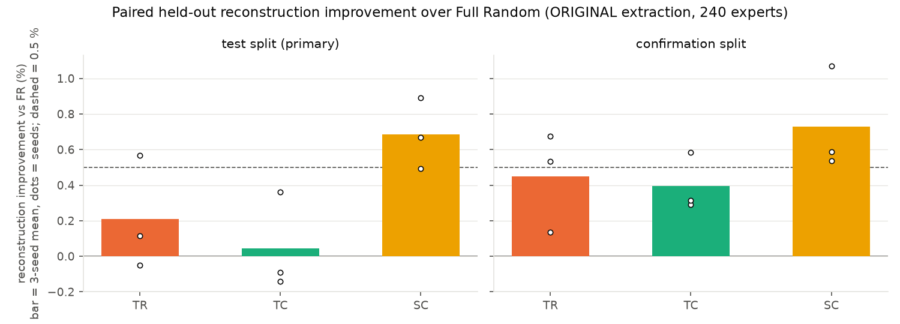
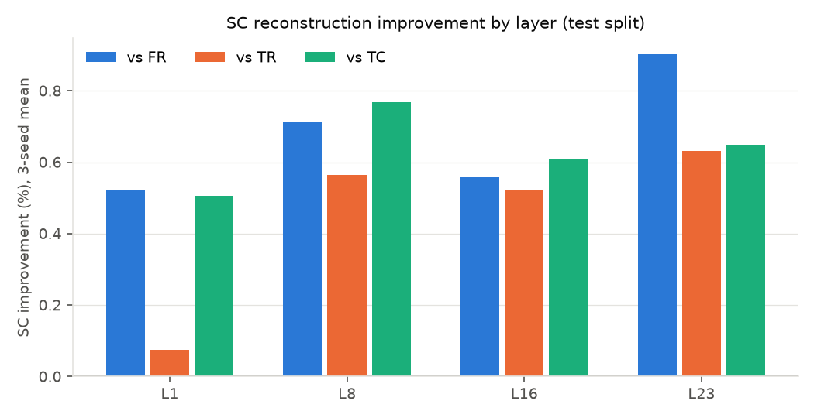
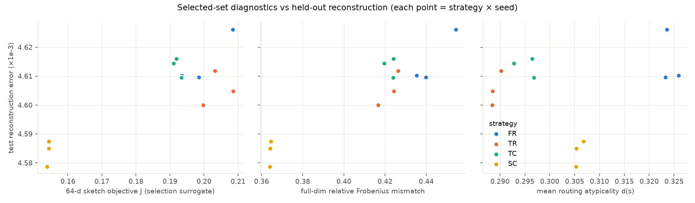
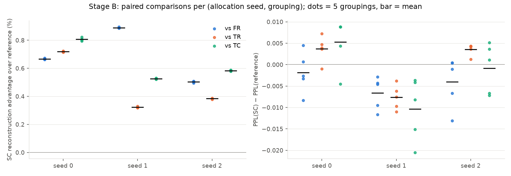

# Full E3 validation of Shared Covariance-aware calibration (SC) — summary

Protocol `8ccc0ce6eaf496cb` (frozen before sketches); selections frozen in `freeze.json` before any SC reconstruction. Qwen1.5-MoE-A2.7B, layers 1/8/16/23 (240 routed experts), B = 128 shared sequences, matched 32-sequence warm start, GPTQ 4-bit / g128 / act-order / percdamp 1.0, seeds 0/1/2.

**Decision (frozen rule, SC vs FR): ROBUST-SUPPORTED**. Other labels: SC_vs_FR_stageA = SUPPORTED, SC_vs_TR_stageA = NO-GAIN, SC_vs_TC_stageA = SUPPORTED, SC_vs_FR_final = ROBUST-SUPPORTED, SC_vs_TR_final = NO-GAIN, SC_vs_TC_final = ROBUST-SUPPORTED

Baselines: stored FR/TR/TC results reused = **True** (FR s0, TR s1, TC s2 re-run through this pipeline: FR_s0: True; TR_s1: True; TC_s2: True).

## 1. Stage A — ORIGINAL extraction (3-seed means)

| strategy | test error ↓ | confirmation error ↓ | test improvement vs FR | confirmation improvement vs FR | PPL ↓ | Δ PPL vs BF16 | Δ PPL vs FR |
|---|---|---|---|---|---|---|---|
| FR (Full Random) | 0.004615 | 0.004580 | — | — | 9.2694 | +0.0323 | — |
| TR (Typical Random) | 0.004606 | 0.004559 | +0.21 % | +0.45 % | 9.2683 | +0.0312 | -0.0010 |
| TC (Typical Coverage-LP) | 0.004613 | 0.004562 | +0.04 % | +0.40 % | 9.2725 | +0.0354 | +0.0031 |
| SC (Shared Covariance-aware) | 0.004584 | 0.004546 | +0.68 % | +0.73 % | 9.2678 | +0.0307 | -0.0016 |

BF16 PPL 9.2371.

Per seed (test / confirmation / PPL):

| strategy | seed 0 | seed 1 | seed 2 |
|---|---|---|---|
| FR | 0.004610 / 0.004573 / 9.2679 | 0.004626 / 0.004592 / 9.2747 | 0.004610 / 0.004575 / 9.2656 |
| TR | 0.004612 / 0.004566 / 9.2680 | 0.004600 / 0.004561 / 9.2747 | 0.004605 / 0.004550 / 9.2623 |
| TC | 0.004616 / 0.004559 / 9.2725 | 0.004609 / 0.004565 / 9.2775 | 0.004614 / 0.004561 / 9.2675 |
| SC | 0.004579 / 0.004548 / 9.2761 | 0.004585 / 0.004543 / 9.2644 | 0.004587 / 0.004548 / 9.2630 |

## 2. Paired comparisons (positive = first strategy better; paired by allocation seed)

| comparison | test r per seed | mean ± sd | confirmation r per seed | conf mean | experts improved per seed (of 240) | experts improved, 3-seed avg | Δ PPL per seed | layers improved |
|---|---|---|---|---|---|---|---|---|
| SC vs FR | +0.67 % / +0.89 % / +0.49 % | +0.68 % ± 0.20 | +0.54 % / +1.07 % / +0.59 % | +0.73 % | 229 / 234 / 227 | 239 | +0.0082 / -0.0103 / -0.0026 | 4/4 |
| SC vs TR | +0.72 % / +0.33 % / +0.38 % | +0.47 % ± 0.21 | +0.40 % / +0.40 % / +0.05 % | +0.28 % | 218 / 200 / 190 | 209 | +0.0080 / -0.0103 / +0.0007 | 4/4 |
| SC vs TC | +0.81 % / +0.53 % / +0.58 % | +0.64 % ± 0.15 | +0.25 % / +0.49 % / +0.27 % | +0.34 % | 230 / 227 / 229 | 234 | +0.0035 / -0.0131 / -0.0045 | 4/4 |
| TR vs FR | -0.05 % / +0.57 % / +0.12 % | +0.21 % ± 0.32 | +0.14 % / +0.68 % / +0.53 % | +0.45 % | 114 / 217 / 139 | 177 | +0.0002 / +0.0000 / -0.0033 | 4/4 |
| TC vs FR | -0.14 % / +0.36 % / -0.09 % | +0.04 % ± 0.28 | +0.29 % / +0.59 % / +0.31 % | +0.40 % | 83 / 191 / 95 | 129 | +0.0047 / +0.0028 / +0.0019 | 2/4 |
| TC vs TR | -0.09 % / -0.21 % / -0.21 % | -0.17 % ± 0.07 | +0.15 % / -0.09 % / -0.22 % | -0.05 % | 96 / 76 / 71 | 76 | +0.0045 / +0.0028 / +0.0052 | 0/4 |

Per-layer improvement (3-seed mean):

| comparison | L1 | L8 | L16 | L23 |
|---|---|---|---|---|
| SC vs FR | +0.52 % | +0.71 % | +0.56 % | +0.90 % |
| SC vs TR | +0.07 % | +0.56 % | +0.52 % | +0.63 % |
| SC vs TC | +0.51 % | +0.77 % | +0.61 % | +0.65 % |

Expert error quantiles (3-seed mean over the 240-expert distribution, test):

| strategy | median | p90 | p95 |
|---|---|---|---|
| FR | 0.004803 | 0.006000 | 0.006216 |
| TR | 0.004792 | 0.006000 | 0.006195 |
| TC | 0.004798 | 0.005996 | 0.006216 |
| SC | 0.004764 | 0.005963 | 0.006168 |

## 3. SC selection and overlap

| seed | J(warm) | J(greedy) | J(final) | accepted swaps | passes | select s | SC ∩ FR | SC ∩ TR | SC ∩ TC | post-warm picks in typical half |
|---|---|---|---|---|---|---|---|---|---|---|
| 0 | 0.3461 | 0.1560 | 0.1539 | 57 | 5 | 15 | 38 | 39 | 41 | 64/96 |
| 1 | 0.3469 | 0.1565 | 0.1544 | 47 | 5 | 14 | 37 | 43 | 45 | 61/96 |
| 2 | 0.3619 | 0.1562 | 0.1544 | 60 | 5 | 15 | 35 | 36 | 38 | 59/96 |

(All overlaps include the 32 shared warm-start sequences.)

## 4. Mechanism diagnostics (3-seed means; descriptive)

| strategy | sketch J | sketch gu / down | full-dim mismatch | full gu / down | mean d(s) | post-warm d(s) | set JS | set L1 | median tokens/expert | p10 tokens | Gini | eff. sources (median) | distinct sources |
|---|---|---|---|---|---|---|---|---|---|---|---|---|---|
| FR | 0.2001 | 0.1485 / 0.2518 | 0.4432 | 0.1960 / 0.6905 | 0.3242 | 0.3357 | 0.00023 | 0.0322 | 4323 | 3877 | 0.0543 | 118.5 | 127.9 |
| TR | 0.2038 | 0.1624 / 0.2453 | 0.4224 | 0.2166 / 0.6283 | 0.2891 | 0.2888 | 0.00045 | 0.0455 | 4306 | 3769 | 0.0654 | 120.9 | 128.0 |
| TC | 0.1921 | 0.1440 / 0.2402 | 0.4225 | 0.1965 / 0.6485 | 0.2953 | 0.2972 | 0.00030 | 0.0348 | 4328 | 3960 | 0.0457 | 120.4 | 128.0 |
| SC | 0.1542 | 0.1054 / 0.2031 | 0.3642 | 0.1548 / 0.5737 | 0.3058 | 0.3111 | 0.00008 | 0.0190 | 4326 | 3922 | 0.0493 | 119.5 | 128.0 |

Spearman association with test error (descriptive; 9 within-seed deltas vs FR / all 12 sets):

| diagnostic | paired Δ vs FR (n = 9) | all 12 sets |
|---|---|---|
| sketch | +0.78 | +0.48 |
| full | +0.82 | +0.76 |
| full_gu | +0.78 | +0.50 |
| full_down | +0.90 | +0.78 |
| d_mean | -0.53 | +0.09 |
| js | +0.62 | +0.44 |
| l1 | +0.58 | +0.48 |
| tok_median | +0.07 | +0.05 |
| gini | +0.20 | -0.04 |
| eff_src | +0.60 | -0.02 |

Per-expert SC − FR (240 experts per seed): fraction of experts with lower mismatch and Spearman(Δ mismatch, Δ relative error):

| seed | lower sketch mismatch | lower full-dim mismatch | ρ(Δsketch, Δerr) | ρ(Δfull, Δerr) |
|---|---|---|---|---|
| 0 | 100 % | 99 % | +0.343 | +0.222 |
| 1 | 100 % | 99 % | +0.505 | +0.411 |
| 2 | 100 % | 98 % | +0.268 | +0.304 |

## 5. Stage B — paired calibration-grouping robustness

Per allocation seed: union of the four strategies' ids, 5 groupings (20261111–15, batches of 8), all four strategies quantized from the same grouping cache. Advantage = (E_ref − E_SC)/E_ref; Δ PPL = PPL(SC) − PPL(ref). Nested analysis (seed > grouping); hierarchical bootstrap over seeds then groupings.

| comparison | recon advantage seed means | pooled grouping SD | overall | 95 % hier. CI | (s,g) SC better | Δ PPL seed means | PPL pooled grouping SD W | overall Δ PPL | 95 % hier. CI | (s,g) SC better PPL | |M|/W |
|---|---|---|---|---|---|---|---|---|---|---|---|
| SC vs FR | +0.667 % / +0.889 % / +0.503 % | 0.005 % | +0.686 % | [+0.504 %, +0.888 %] | 15/15 | -0.0018 / -0.0066 / -0.0040 | 0.0049 | -0.0041 | [-0.0072, -0.0011] | 11/15 | 0.85 |
| SC vs TR | +0.718 % / +0.323 % / +0.384 % | 0.004 % | +0.475 % | [+0.323 %, +0.718 %] | 15/15 | +0.0037 / -0.0076 / +0.0035 | 0.0025 | -0.0001 | [-0.0073, +0.0043] | 6/15 | 0.05 |
| SC vs TC | +0.807 % / +0.526 % / +0.584 % | 0.007 % | +0.639 % | [+0.527 %, +0.806 %] | 15/15 | +0.0053 / -0.0103 / -0.0008 | 0.0063 | -0.0020 | [-0.0100, +0.0053] | 8/15 | 0.31 |

Grouping-averaged means (15 configurations each): FR recon 0.004615, PPL 9.2716; TR recon 0.004606, PPL 9.2676; TC recon 0.004613, PPL 9.2694; SC recon 0.004584, PPL 9.2674.

Fresh-process determinism control (SC s0 G20261111): {'weights_exact': True, 'ppl_exact': True, 'recon_exact': True, 'per_window_exact': True, 'reproduced_bitwise': True}

## 6. Compute (equal sequence budget ≠ equal profiling compute)

| item | FR | TR / TC | SC |
|---|---|---|---|
| initial full-model activation cache (reused, all) | 386 s | same | same |
| candidate-pool routing profile | — | 357 s | — (counts come from the sketch pass) |
| covariance sketch pass (4 layers × 2,000 seqs, 240 experts) | — | — | 617 s; peak GPU 3.3 GB, RSS 14.7 GB |
| selection | ~0 | LP (TC) | 15 / 14 / 15 s (+ 2 s load); peak GPU 16.0 GB |
| disk | — | — | sketches 8.0 GB (+ 5.9 GB full-dim diagnostic reference) |
| calibration Hessian replay / GPTQ / PPL (per config) | same | same | 30 s / 211 s / 23 s; peak GPU 8.4 GB, peak CPU 51 GB |

SC extra cost over FR ≈ 632 s ≈ **3539 extra random sequences** at 0.178 s per full-model sequence forward (E3 cost model).

## 7. Interpretation

Written after all Stage A and Stage B results were in. The decision rule (`moe_calib/shared_covariance_selection.py:decide`, threshold 0.5 %) and the protocol (sha `8ccc0ce6eaf496cb`) were frozen before any SC reconstruction and were not changed. The test split was never used for selection or tuning: SC optimizes a 64-d sketch objective over pool rows [0, 2000) only.

### Q1. Does SC beat Full Random?
**Yes, on isolated expert reconstruction.**
- Paired test improvement: +0.67 / +0.89 / +0.49 % (mean +0.68 %). Seed 2 is 0.006 pp below the 0.5 % materiality line on its own; the frozen rule uses the 3-seed mean together with sign consistency.
- Confirmation split: +0.54 / +1.07 / +0.59 %.
- Breadth: 229 / 234 / 227 of 240 experts improve, and all four layers improve (+0.52 to +0.90 %).
- The p90/p95 expert error also drops, so the gain is not driven by a few experts.
- Stage A label SUPPORTED; final label with grouping robustness **ROBUST-SUPPORTED**.

### Q2. Does SC beat the routing-aware baselines?
- **vs Typical Coverage-LP: yes.** Test +0.64 % mean (+0.81 / +0.53 / +0.58), every seed above 0.5 %, 4/4 layers. ROBUST-SUPPORTED.
- **vs Typical Random: no, under the frozen rule (NO-GAIN).** SC is better on every seed (+0.72 / +0.33 / +0.38 %, mean +0.47 %), every layer, and 15/15 grouping configurations. The mean, however, is below the pre-registered 0.5 % threshold, and the confirmation-split margin is only +0.28 %.
- Read this as: SC is consistently better than TR, but by less than the materiality bar. It does not mean SC is no better than TR.
- Part of SC's margin over FR is available more cheaply: TR alone gets +0.21 % test / +0.45 % confirmation over FR.

### Q3. Does the MVP result generalize?
**Yes, in direction and roughly in size, although the two settings are not directly comparable.**
- The MVP's SC-vs-SR effect (+0.55 % test, token-matched) reappears as +0.68 % for SC vs FR at full scale.
- Raw errors must not be compared across the two studies: the expert sets, metric aggregation and test subset all differ.

| aspect | MVP (`runs_expertwise_mvp`) | full E3 (this study) |
|---|---|---|
| layers / experts | L16 only / 8 experts | L1, L8, L16, L23 / all 240 routed experts |
| objective scope | 8 experts × 3 projections | 240 experts × 2 Hessian groups (gate+up, down), stacked |
| warm start | none | matched 32-sequence warm start shared with FR/TR/TC |
| token control | token-matched (subsampled to equal per-expert tokens) | none; natural exposure (median ≈ 4,320 tokens/expert for all strategies) |
| baseline | Shared Random (SR) | FR, TR, TC from the frozen E3 manifest (stored, reproduced bitwise) |
| metric | per-sequence relative error, mean over 8 experts, 128 test sequences | E3 relative error over 240 experts, full test split, plus confirmation split |
| downstream | none | partial-model WikiText-2 PPL, plus a 5-grouping Stage B |
| SC gain vs random | +0.55 % test / +0.62 % confirmation | +0.68 % test / +0.73 % confirmation (vs FR) |

### Q4. Is covariance matching associated with the reconstruction gains?
**Yes, descriptively, though the evidence is not causal.**
- SC lowers the selection surrogate J from ≈0.20 to 0.154.
- The gain is not specific to the 64-d sketch. The held-out full-dimensional covariance mismatch also falls, from 0.443 (FR) to 0.364. It falls for gate+up (0.196 → 0.155) and for down (0.691 → 0.574), and for 98–100 % of experts on each seed.
- Across the 9 within-seed deltas vs FR, test error tracks the full-dimensional mismatch (Spearman +0.82; down projection +0.90) and the sketch J (+0.78).
- It does not track token count (+0.07), Gini (+0.20) or routing atypicality d(s) (−0.53).
- At the per-expert level the association is weaker but positive: ρ(Δsketch, Δerr) = +0.27 to +0.51.
- SC does not achieve its gain by moving toward typical sequences: its mean d(s) is 0.306, between FR (0.324) and TR/TC (≈0.29).
- These are associations across 12 selected sets that differ in more than one respect, not a controlled intervention.

### Q5. Does the gain survive calibration-grouping noise?
**Yes, clearly.**
- In Stage B every (seed, grouping) configuration favors SC over each baseline: 15/15 vs FR, TR and TC.
- The pooled grouping SD of the reconstruction advantage is 0.004–0.007 pp, about 100× smaller than the effect.
- Hierarchical 95 % CI for SC vs FR: [+0.50 %, +0.89 %].
- The fresh-process control (SC s0 G20261111) reproduced weights, reconstruction, PPL and per-window NLL bitwise.
- The remaining uncertainty is between allocation seeds (0.50–0.89 %), not between groupings.

### Q6. Does the reconstruction gain transfer to perplexity?
**Not established. There is at most a small directional signal vs FR.**
- Stage A ΔPPL vs FR is mixed in sign: +0.0082 / −0.0103 / −0.0026.
- In Stage B the SC − FR seed means are all negative (−0.0018 / −0.0066 / −0.0040; overall −0.0041; hierarchical CI [−0.0072, −0.0011]; 11/15 configurations favor SC).
- But the pooled grouping SD (0.0049) is larger than |mean| (|M|/W = 0.85). By the pre-stated criterion, a PPL gain is therefore not claimed.
- For scale, −0.004 PPL would be about 13 % of the 4-layer quantization gap to BF16 (+0.032).
- Against TR and TC there is no PPL signal (overall −0.0001 and −0.0020; CIs straddle 0; 6/15 and 8/15).
- Conclusion: the reconstruction improvement is real but too small to separate from calibration-grouping noise in 4-layer partial-model PPL.

### Q7. Is the gain worth the extra profiling compute?
**Only when the number of calibration sequences is the binding constraint, not when compute is.**
- SC's extra cost over FR is ≈632 s: the sketch pass (617 s) plus selection (~15 s). That equals about 3,500 random sequences' worth of full-model forwards at 0.178 s/sequence, plus 8 GB of sketch storage.
- What do more random sequences buy?
  - In `runs_low_budget`, Full Random goes from 0.004816 at B = 64 to 0.004615 at B = 128: −4.2 % per doubling.
  - SC's 3-seed mean (0.004584) corresponds to an FR budget of about B ≈ 143 on a log-linear extrapolation of those two points. This extrapolation is an estimate, not a measurement.
  - So the SC gain is worth roughly 15 extra random calibration sequences, which cost seconds of Hessian replay.
- The sketch pass is amortized across allocation seeds and could be reused across budgets. Even so, under a compute budget, adding random sequences is far cheaper.
- SC is useful when B itself is fixed, for example by a cap on calibration data, on Hessian replay, or on per-expert token storage. It is not useful as a compute-efficient route to lower reconstruction error.

### Classification
**SUPPORTED (limited).**
- SC vs FR passes the frozen rule as ROBUST-SUPPORTED; SC vs TC is also ROBUST-SUPPORTED.
- The gain generalizes from the 8-expert, single-layer MVP to all 240 experts in 4 layers, and it survives calibration-grouping noise.
- Limits:
  - (i) Against Typical Random the gain is consistent but below the 0.5 % materiality bar (NO-GAIN under the rule).
  - (ii) No perplexity improvement is established.
  - (iii) The effect is small: about the value of ~15 extra random sequences, bought at roughly 3,500 sequence-forwards of profiling.
  - (iv) Only one model, 4 of 24 layers, B = 128, 4-bit GPTQ g128.

