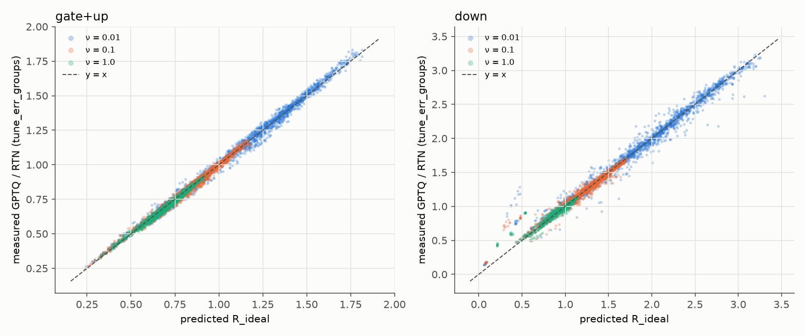
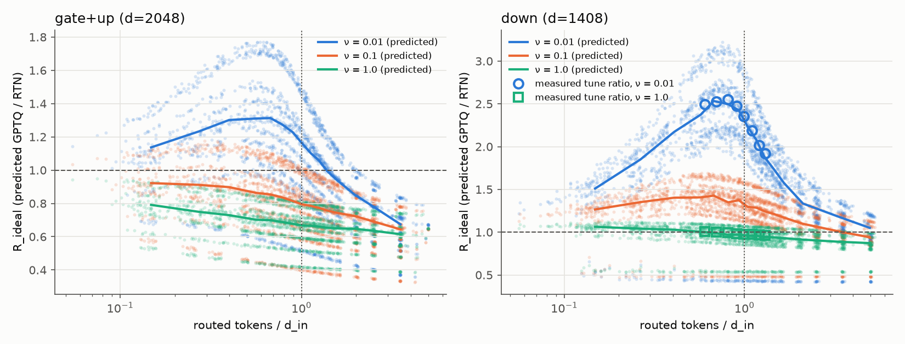
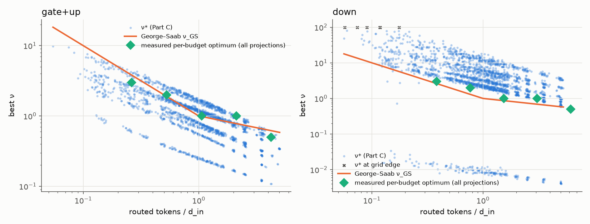

# Theorem-1 check of the GPTQ damping mechanism

**Frozen verdict: `T1-PASS-BOTH`.** Both groups pass the frozen gate by a wide margin:

| group | cells | median Spearman (R_ideal vs measured, over ν) | argmin agreement (±1 grid step) | gate |
|---|---|---|---|---|
| gate+up | 2,400 | 1.000 | 100.0 % | ≥ 0.8 and ≥ 70 % → PASS |
| down | 2,400 | 1.000 | 99.0 % | ≥ 0.8 and ≥ 70 % → PASS |

**Answer to the main question:** yes. The idealized closed form of GPTQ's error predicts our measured damping behaviour
almost exactly, and it needs no quantization at all. R_ideal(ν) = tr(MᵀΣM)/tr(Σ) depends only on the calibration
Hessian, the damping and the tuning second moment. From it we recover:
- **The weak-damping peak.** At ν = 0.01, R_ideal reproduces the observed GPTQ/RTN ratio in every tokens/d_in bin of
  `damping_threshold_report.md` §2 to within ±0.02. The peak lands in the same bins: gate+up [0.5, 0.75) and
  down [0.75, 1.0).
- **Its disappearance at ν = 1.0.** Every bin again matches to within ±0.01.
- **The best ν per budget and per group.** For every prefix and both groups, the predicted best ν equals the measured
  one.

Protocol, ν grids, expert selection, metrics and the verdict rule were frozen in
`runs_theorem1_check/protocol.json` before any measurement. Its hash is unchanged. The four deviations and one
protocol-sanctioned decision are listed at the end and in `runs_theorem1_check/deviations.json`.

## What was tested

GPTQ's per-row error is u = MΔ. Δ is the rounding residual of each step, and M is unit lower-triangular,
M = (diag(U)⁻¹U)ᵀ, with U = `Hinv` of `gptq.py`. Each column of M is minus the ridge regression of that coordinate on
the later ones, with A = Ĥ + ν·mean(diag Ĥ)·I. Under two idealized rounding assumptions:
- **R1:** the residuals are martingale differences.
- **R2:** the residuals share a common variance.

the expected error is σ²·tr(MᵀΣM), and RTN's is σ²·tr(Σ).

Quantities:
- **R_ideal = tr(MᵀΣM)/tr(Σ):** predicted GPTQ/RTN ratio.
- **R_w = Σ_t col_err2_t · m_tᵀΣm_t:** drops R2, keeps R1.
- **e_meas = Σ_r u_rᵀΣu_r:** from the actual quantized weights.
- **Σ:** tuning-split XᵀX/n in fp64, the same rows that `tune_err_groups` scores.

## Correctness checks (all passed)

| Check | Result |
|---|---|
| `tests/test_theorem1.py` (40 tests, d=24, g=4, blocksize 8) | Cholesky form = nested-ridge form (≤1e-10); frozen lazy-batch solver = column-by-column reference (≤1e-5); u = MΔ, Σ col_err2 = ‖Δ‖²_F; dead column decoupled; R_ideal → 1 as ν → ∞ |
| u = MΔ for the **unmodified** `gptq.py` code run in fp64 (dtype proxy) | 1e-15 relative, with groups, lazy batches and a dead column |
| Same identity, production fp32 run | 1.1e-6 relative (fp32 cancellation in W − Q) |
| In situ on the real model: Δ = M⁻¹u reconstructed per column vs the solver's `col_err2` | max relative error 5.9e-6 over all 11,520 B2 cells |
| Reproducibility: recomputed `tune_err_groups` vs `damping_threshold_raw` / `damping_selection_raw` (seed 0, L1) | 2,040 comparisons, all ≤ 1e-6 relative |
| Part C Ĥ (own routed-activation collector) vs `hessians()` for the B32 prefix, 3 experts × 2 groups × 4 layers × 2 seeds | max relative Frobenius error 3.2e-7 after trace normalization; token counts identical |
| Cholesky failures | none |
| Dead columns | none (no expert has zero tokens at B16) |

## T1 — agreement over the ν grid (frozen gate)

Primary analysis:
- **Cells:** all 60 experts × 4 layers × 2 seeds × 5 prefixes = 2,400 per group.
- **ν grid:** the 10 values measured per group in `damping_threshold_raw.jsonl`.
- **Measured ratio:** existing `tune_err_groups`, GPTQ/RTN.

| group | prefix | median Spearman | argmin agree | best ν, predicted / measured (expert-mean curves) | median R_ideal / measured at ν=0.01 / ν=1.0 |
|---|---|---|---|---|---|
| gu | 16 | 1.000 | 100.0 % | 2.0 / 2.0 | 0.994 / 1.003 |
| gu | 32 | 1.000 | 100.0 % | 1.5 / 1.5 | 0.991 / 1.002 |
| gu | 64 | 1.000 | 100.0 % | 1.0 / 1.0 | 0.994 / 1.002 |
| gu | 128 | 1.000 | 100.0 % | 0.5 / 0.5 | 0.996 / 1.001 |
| gu | 256 | 0.988 | 100.0 % | 0.3 / 0.3 | 0.995 / 1.000 |
| down | 16 | 1.000 | 99.4 % | 5.0 / 5.0 | 0.997 / 1.003 |
| down | 32 | 1.000 | 99.2 % | 5.0 / 5.0 | 0.995 / 1.002 |
| down | 64 | 1.000 | 98.8 % | 3.0 / 3.0 | 0.995 / 1.000 |
| down | 128 | 0.988 | 99.2 % | 1.5 / 1.5 | 0.992 / 0.997 |
| down | 256 | 0.988 | 98.3 % | 1.0 / 1.0 | 0.990 / 0.995 |

Secondary analysis, on the B2 experts over the full 12-ν grid (including 0.03 and 0.05, measured in this run):

| group | median Spearman | argmin agree |
|---|---|---|
| gu | 0.993 | 100 % |
| down | 1.000 | 98.1 % |

Against e_meas/e_rtn instead of `tune_err_groups`, both groups reach 1.000 and 100 %.

**The model also explains the per-budget optima of `adaptive_damping.md` (3.0/2.0/1.0/1.0/0.5).** That rule picks
one ν for all three projections. The theory, confirmed by measurement, says down wants 2.5–3.3× more damping than
gate+up at every budget. The measured all-projection optimum sits between the two group optima.

**Where the prediction is off.** About 2 % of down cells (53 / 2,400) miss the measured level by more than 20 %.
They come from about 7 experts, mostly L1 e0/e42/e33 and L23 e57/e26/e25. In these cells:
- GPTQ beats RTN at every ν, and the predicted ratio is too low (L1 e42 at B32, ν=0.01: R_ideal 0.44 vs
  measured 0.79).
- The ranking over ν is still right, with Spearman 1.
- T2 places the error in neither R1 nor R2: for e42, the R1 gap is +0.02 and the R2 gap is −0.23. Most of it is in a
  third factor, described under T2.

## T2 — why the idealization holds (B2: 12 experts/layer, 480 cells per group × ν)

Median [IQR]:

| group | ν | R1 gap e_meas/R_w−1 | R2 gap R_w/(mean col_err2·tr)−1 | R3 gap* | clamped weights (working) |
|---|---|---|---|---|---|
| gu | 0.01 | −0.001 [−0.002, −0.000] | −0.001 [−0.003, 0.001] | 0.008 [0.004, 0.012] | 0.052 % |
| gu | 1.0 | 0.000 [−0.001, 0.001] | −0.001 [−0.002, −0.000] | −0.000 [−0.005, 0.002] | 0.016 % |
| down | 0.01 | −0.001 [−0.003, −0.000] | −0.007 [−0.016, −0.002] | 0.013 [0.005, 0.019] | 0.051 % |
| down | 1.0 | −0.000 [−0.001, 0.001] | −0.003 [−0.006, 0.001] | −0.000 [−0.002, 0.002] | 0.018 % |

- **R1 holds.** Error feedback, the 4-bit grid and clipping leave the residuals effectively uncorrelated in the
  Σ-metric. The gap stays under 0.5 % in IQR at every ν.
- **R2 holds.** It degrades only slightly at weak damping for down (−0.7 %).
- **Clipping is negligible.** It touches ≤ 0.15 % of weights against the original W, and ≤ 0.07 % of working weights.
- **\*R3 (descriptive, not in the frozen protocol).** The remaining factor, defined so that
  (e_meas/e_rtn)/R_ideal = (1+R1)(1+R2)(1+R3). It is GPTQ's mean residual variance × tr(Σ) relative to RTN's actual
  Σ-weighted error, i.e. whether GPTQ and RTN share σ². It is ≈ 0 in general. It explains the outlier experts above:
  for L1 e42, R3 ≈ +1.3, meaning RTN's error happens to avoid that expert's dominant Σ directions.

The full 12-ν table is in `runs_theorem1_check/report.md`.

## T3 — peak location

R_ideal at ν = 0.01 (B1, all experts/prefixes/seeds) against the observed ratio, with identical points per bin:

| tokens/d_in | gu R_ideal | gu observed | down R_ideal | down observed |
|---|---|---|---|---|
| [0.25, 0.5) | 1.321 | 1.329 | 2.096 | 2.101 |
| [0.5, 0.75) | **1.374** | **1.389** | 2.432 | 2.430 |
| [0.75, 1.0) | 1.285 | 1.274 | **2.536** | **2.559** |
| [1.0, 1.25) | 1.118 | 1.125 | – (14 pts) | – (14 pts) |
| [1.25, 1.5) | 1.009 | 1.021 | 1.830 | 1.821 |
| [2.0, 3.0) | 0.784 | 0.788 | 1.262 | 1.267 |
| [5.0, ∞) | 0.618 | 0.634 | 0.992 | 1.010 |

**Part C controlled sweep.** Per expert, the peak of R_ideal(0.01) over n/d, with whole-sequence subsets
(3 experts/layer × 4 layers × 2 seeds = 24 per group):

| group | peak n/d median [IQR] | peak R median [IQR] | peak at sweep edge |
|---|---|---|---|
| gate+up | **0.53** [0.50, 0.59] | 1.31 [1.15, 1.55] | 2 / 24 |
| down | **0.73** [0.69, 0.81] | 2.48 [2.21, 2.68] | 2 / 24 |

The peak sits clearly **below** n/d = 1 in both groups, and lower for gate+up than for down. It is not at the
interpolation threshold n = d that the original double-descent hypothesis suggested. It also does not scale as a
fixed fraction of d.

**The down anchors fill the observed gap at [1.0, 1.25).** These run actual GPTQ on Part C subsets.
- **At ν = 0.01** the measured tune ratio is 2.55 at n/d 0.81, 2.36 at 0.99, 2.19 at 1.10 and 1.92 at 1.31.
- **R_ideal and e_meas/e_rtn follow within 1–2 %**, with an R1 gap of −0.2 %.
- **The curve is smooth.** There is no hidden spike in the 14-point bin.
- **At ν = 1.0** the ratio is flat at 0.95–1.0 across the whole range.

The two edge peaks are the anomalous L1 median expert e42, which has R < 1 for all n.

## T4 — best ν vs n/d (Part C)

Fit of log ν* = a + b·log(d/n), with 95 % CIs from a cluster bootstrap over experts:

| group | side | b [95 % CI] | a (ν* at n=d ≈ eᵃ) |
|---|---|---|---|
| gate+up | n < d | 0.61 [0.58, 0.64] | −0.05 (≈ 0.95) |
| gate+up | n > d | 0.72 [0.67, 0.77] | −0.03 (≈ 0.97) |
| down | n < d | 0.82 [0.68, 0.99] | 0.91 (≈ 2.5) |
| down | n > d | 0.76 [0.71, 0.83] | 0.97 (≈ 2.6) |

**Compared with the George–Saab rule** ν_GS = d/(n^{1/3}·min(n,d)^{2/3}), which implies b = 1 for n < d and b = 1/3
for n > d:
- **Shape.** The fitted slopes are neither: about 0.6–0.8 on both sides, with no kink at n = d.
- **Level.** For gate+up, ν_GS happens to be right at n ≈ d (ν* ≈ 1). For down, ν* is about 2.5× higher than ν_GS.
- **Cost.** Using ν_GS instead of the per-subset optimum costs little, because the curve is flat near its minimum:
  - median excess R of +0.35 % for gate+up (IQR 0.05–0.9 %);
  - median excess R of +2.4 % for down (IQR 1.1–4.8 %).
- **Edge cases.** 6 / 2,144 down subsets have ν* at the 1e-3 or 1e2 edge, from the anomalous experts. They are
  excluded from the fit.

## Interpretation and implications

1. **The damping phenomenology is explained.** The 16→32 anomaly, the peak below n = d, its removal by damping, and the
   budget-dependent optimum all follow from the closed form. Rounding is close to ideal (R1 and R2 gaps < 1 %), so
   the excess error is entirely the error-feedback geometry: how M amplifies Δ in the tuning metric, given a
   rank-poor Ĥ.
2. **Damping can be chosen without quantizing.** R_ideal(ν) costs about 45 ms per gate+up expert per ν on the MIG slice
   and needs no calibration-quality labels. Minimizing it per group reproduces the measured optimum on 98–100 % of cells
   within one grid step.
3. **Per-group damping is the natural next step.** down consistently wants about 2.5× the damping of gate+up. This is
   a prediction to validate; nothing in production was changed.

## Deviations from the frozen protocol

| ID | Deviation |
|---|---|
| D1 | The frozen B2 text says "12 per layer" but lists only 6 ranks, {0,1},{29,30},{58,59}. I resolved it to 12 by widening each stratum to {0–3}, {28–31} and {56–59}, a superset of the frozen ranks. A 15-minute partial run with 6 experts was stopped before any analysis beyond a pipeline dry-run. It is archived unchanged in `runs_theorem1_check/aborted_b2_6experts/`, and Part B was rerun from scratch. |
| D2 | For gate+up, the frozen R2-gap formula is ambiguous because two projections share M and Σ. I use mean(col_err2) per projection, summed over the two. Fixed after a GPU smoke test, before any recorded run. |
| D3 | Part C data does not use `tune_holdout`, because it caps each sequence at 128 routed tokens and stores fp16, which would break the frozen token-count invariant. A hook collector on the same pre-hooks keeps all routed tokens in bf16 for the 3 selected experts only. It passes the frozen invariant. (Also stated in the protocol's `part_C.data`.) |
| D4 | The unit-test tolerance u = MΔ ≤ 1e-6 relative is unattainable for the fp32 solver because of cancellation in W − Q. The identity is verified at ≤ 1e-6 by running the unmodified `gptq.py` code in fp64, and at ≤ 1e-5 for the fp32 run. |
| N1 | Sanctioned by the protocol: Part C seed 1 was added after seed 0 took 0.43 h. |
| Additions | The descriptive R3 factor (T2), the e_meas-based T1 secondary analysis, and the outlier-expert analysis are additions. None of them affects the gate. |
| Coverage limit | gate+up cannot reach n/d = 5 for every expert with 256 sequences (B256 tokens 6.4k–10.9k gives n/d up to 3.2–5.3). Subset sizes were capped at 256 sequences with a single draw. |

## Files

- **Code:** `diagnostics/theorem1_check.py` (protocol / grid / sweep), `diagnostics/report_theorem1_check.py`,
  `tests/test_theorem1.py`.
- **Outputs in `runs_theorem1_check/`:**
  - `protocol.json` (frozen), `deviations.json`;
  - `raw_grid.jsonl` (480 records), `grid_events.jsonl`, `raw_sweep.jsonl` (48 curve records, 24 anchor records,
    8 invariant records);
  - `report.json`, `report.md`, `figures/*.png`;
  - `run_all.sh`, `logs/`, `aborted_b2_6experts/`.
- **Untouched:** `moe_calib/gptq.py` (sha256 58e40d1c…), `configs/frozen_b4.json`, all existing run outputs.
  Tuning split only.
